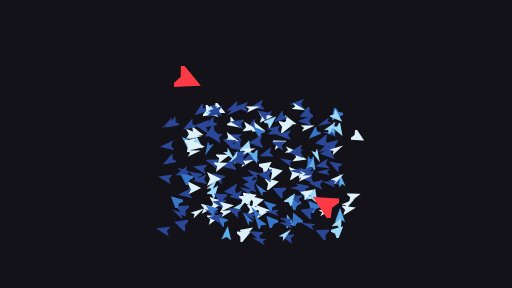
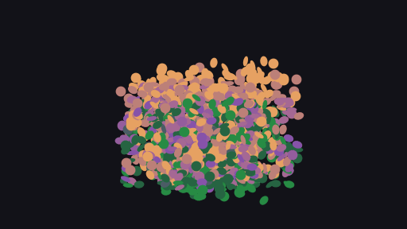
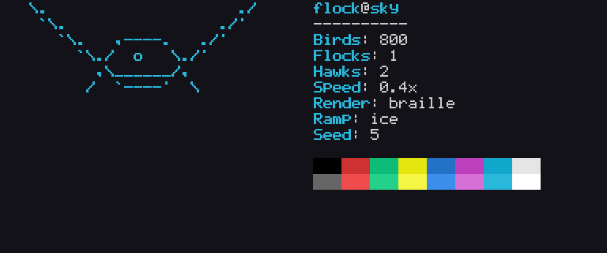
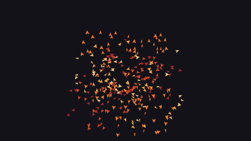
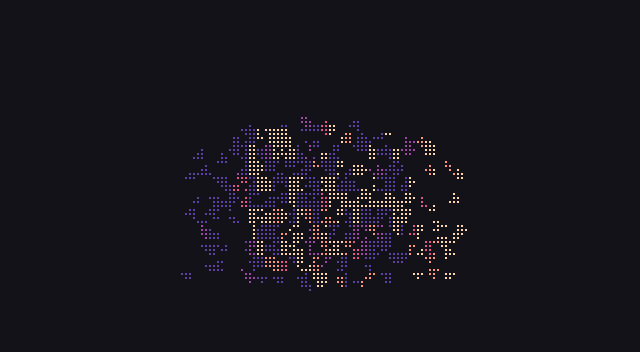

# cbirds

A flock of birds in your terminal.

<p>
<a href="https://github.com/clainstone/cbirds/actions/workflows/tests.yml"></a>
<a href="https://github.com/clainstone/cbirds/tags"></a>
<a href="LICENSE"></a>


<a href="#terminals"></a>
</p>

<table>
<tr>
<td width="50%"></td>
<td width="50%"></td>
</tr>
<tr>
<td align="center"><code>cbirds --render kitty --hawks 2 --color ice --speed 0</code></td>
<td align="center"><code>cbirds --picture docs/scene.png --shape dot -n 1500 -s 16</code></td>
</tr>
<tr>
<td width="50%"></td>
<td width="50%"></td>
</tr>
<tr>
<td align="center"><code>cat docs/neofetch.txt | cbirds</code></td>
<td align="center"><code>cbirds --clock-at 10:09:52</code></td>
</tr>
<tr>
<td width="50%"></td>
<td width="50%"></td>
</tr>
<tr>
<td align="center"><code>cbirds --render kitty --flocks 3 --color prism</code></td>
<td align="center"><code>cbirds --preset murmuration --color dusk</code></td>
</tr>
</table>

Craig Reynolds' boids, drawn in braille in any terminal, and as sprites over
the Kitty graphics protocol in Kitty and Ghostty. Besides the flock, it flies
the text you pipe into it, writes a sign or the time, draws a PNG, and shares
one sky between terminals. One C99 program, no dependencies. Every clip on
this page was recorded by cbirds itself. [docs/README.md](docs/README.md) has
the command behind each, and more clips: `--matrix`, `--depth --trails`,
`--render sextants`, `--say`.

## Install

Homebrew, on macOS and Linux:

<!-- test: brew-install -->
```
brew install clainstone/tap/cbirds
```

apt, on Debian 12, Ubuntu 22.04 and later and their derivatives, on amd64 or
arm64, from its [apt repository](https://clainstone.com/apt):

<!-- test: apt-install -->
```
sudo apt install curl
curl -fsSL https://clainstone.com/apt/cbirds.gpg | sudo tee /etc/apt/keyrings/cbirds.gpg >/dev/null
echo "deb [signed-by=/etc/apt/keyrings/cbirds.gpg] https://clainstone.com/apt stable main" | sudo tee /etc/apt/sources.list.d/cbirds.list
sudo apt update
sudo apt install cbirds
```

Both come with completions for bash, zsh and fish, and `brew upgrade` or
`sudo apt upgrade` keeps them up to date. The `.deb` files alone, without the
repository and so without updates, are on the
[release page](https://github.com/clainstone/cbirds/releases/latest).

From source, on Linux or macOS, with a C compiler and `make` and nothing else:

```
git clone https://github.com/clainstone/cbirds
cd cbirds
make
sudo make install
cbirds
```

That puts one file, `/usr/local/bin/cbirds`; `make install PREFIX="$HOME/.local"`
puts it in your home instead. `make test` runs the tests, and the build honours
`CC`, `CFLAGS`, `LDFLAGS`, `PREFIX` and `DESTDIR`.

<details>
<summary>Uninstall</summary>

<!-- test: brew-uninstall -->
```
brew uninstall cbirds
brew untap clainstone/tap
```

<!-- test: apt-uninstall -->
```
sudo apt remove cbirds
sudo rm /etc/apt/sources.list.d/cbirds.list /etc/apt/keyrings/cbirds.gpg
sudo apt update
```

Leave out `brew untap` to keep the tap, and the last two apt lines to keep the
repository; a `.deb` installed on its own goes with the first line alone. From
source, in the clone: `sudo make uninstall`, or
`make uninstall PREFIX="$HOME/.local"` for an install in your home.

</details>

## Use

```
cbirds                              a flock in braille, in your terminal's own colours
cbirds --render kitty               sprites, in Kitty or Ghostty
cbirds --preset murmuration         the starling look
cbirds --hawks 2 --color ice        something to watch
cbirds --flocks 3 --color prism     three flocks that keep to their own
cbirds --depth --trails             a second sky behind the first
cbirds --matrix                     it is raining birds
fastfetch | cbirds                  the letters of anything take flight
cbirds --say "back in five"         the flock writes it, and holds it as a sign
cbirds --clock --seconds            the flock tells the time, to the second
cbirds --picture logo.png           the flock draws a PNG
cbirds --link                       one sky across several terminals
cbirds --screensaver --clock        a lock screen that tells the time; any key quits
```

It opens by writing BOIDS, lets go, and flocks. Move the pointer into the
flock and it scatters; press `q` and it flies off the top. Left alone for a
minute, it moves one slider a notch every four seconds, and any key ends that.
`h` opens the panel of sliders, and `--panel` opens it from the start:
lowercase lowers, uppercase raises, one press is one notch. The
[manual](docs/manual.md#the-panel) says more about the sliders.

```
╭────────────────────────────────────╮
│ boundary   ▓▓▓▓░░░░░░░░  0.20  b/B │
│ separation ▓▓▓▓░░░░░░░░ 0.005  s/S │
│ alignment  ▓▓▓▓░░░░░░░░  1.50  a/A │
│ turning    ▓▓▓▓▓▓▓▓░░░░   70°  t/T │
│ perception ▓▓▓▓▓▓░░░░░░  36px  p/P │
│ speed      ▓░░░░░░░░░░░  0.4×  v/V │
│ frame        0.6ms    31KB  60fps  │
│ quit       q                       │
╰────────────────────────────────────╯
```

| key | | key | |
|---|---|---|---|
| `b`/`B` `s`/`S` `a`/`A` `t`/`T` `p`/`P` `v`/`V` `g`/`G` | one notch down, one up | `h` | panel |
| `Space` | pause | `.` | one frame |
| `0` | back to the defaults | `Tab` | next preset |
| `+` `-` | more birds, fewer | `k` `K` | a hawk more, one fewer |
| `e` | tails | `q` | quit |
| `Enter` | letters off, or home | | |

## Anything can fly

Pipe text into cbirds and the text is the flock.

```
fastfetch | cbirds
figlet -f big hello | cbirds
git log --oneline --graph --color=always | cbirds
cbirds --text poem.txt
```

It opens with the text exactly as the command printed it, in its own colours.
A few seconds later one letter leaves and the ones near it follow, and the
letters fly as a flock. After twenty seconds or so they are called home, and
every letter lands on its own cell. `Enter` sends the letters off, or calls
them home at once, and the pointer lifts the letters it touches. How a pipe is
read, what goes with text and how to record it are in the
[manual](docs/manual.md#anything-can-fly).

## Signs, the clock and pictures

`--say TEXT` has the flock write TEXT where it would write BOIDS, and hold it
for thirty to forty-five seconds; then it lets go, flies as a murmuration, and
writes it again. The rest of the flock wheels round the sign, not through it.
`--font-size ROWS` sets the letters from 4 to 10 rows tall.

`--clock` writes the time, HH:MM, in local time, and `--seconds` adds the
seconds. At each new minute only the digits that change let go and are written
again, so the clock can be read at any moment.

`--picture FILE` has the flock draw a PNG, in at most eight of its colours, or
in shades of a ramp if `--color` is given. `--shape dot` and more birds,
`-n 2000`, draw it best.

A key does not end a sign, and birds scattered by the pointer or a hawk come
back when it has gone. Sizes, layout, the letters a sign can write and how to
record a clock are in the [manual](docs/manual.md#signs-the-clock-and-pictures).

## Screensaver

`--screensaver` quits at once on any key, mouse click or pointer movement, with
no flight out. Input in the first half second is ignored, because it is
whatever started the lock. It goes with everything else, so
`cbirds --screensaver --clock` is a lock screen that tells the time. For tmux,
which locks a client after `lock-after-time` idle seconds and runs `lock-command`
on it:

```
set -g lock-after-time 300
set -g lock-command "cbirds --screensaver --clock"
```

And in zsh, which sends itself an alarm after `TMOUT` idle seconds at the
prompt and runs `TRAPALRM`:

```
TMOUT=300
TRAPALRM() { cbirds --screensaver --clock }
```

## One sky, several terminals

```
cbirds --link        # in one terminal
cbirds --link        # in another
```

```
 first window             second window            third window
┌──────────────────────┐ ┌──────────────────────┐ ┌──────────────────────┐
│            > >> >>>  │ │  >> >                │ │                      │
│                      │ │             < << <<  │ │  << <                │
└──────────────────────┘ └──────────────────────┘ └──────────────────────┘
```

Birds that fly out of the edge of one window fly in through the edge of the
next, at the same height and in the same direction, and hawks cross as well.
Two terminals side by side, or two panes of a split, become one sky. The
windows lie in a row in the order they were started, so start them from left
to right. Each keeps its own settings, and a sign goes with it. No clip of it
is on this page: a recording has one window. The row, the room in a window and
the sockets the windows talk through are in the
[manual](docs/manual.md#one-sky-several-terminals).

## Terminals

cbirds draws in braille by default, in every terminal: no terminal is guessed
at. `--render sextants` and `--render blocks` are bolder text versions;
sextants need a font from 2020 or later, blocks work everywhere. Only the cells
that changed are sent, and the background is never painted, so the flock wears
your theme.

`--render kitty` draws real sprites over the Kitty graphics protocol, and is
made for **Kitty** and **Ghostty**. WezTerm, Konsole, iTerm2, Warp and Rio
answer for the protocol and then draw too few birds, the wrong ones or none,
and inside tmux the sprites never reach the terminal.

If braille does not look right in your terminal, open an issue and say which
terminal it is. That is the report that helps most.

## Options

`cbirds -h` prints the options a newcomer needs on one screen, and
`cbirds --help` every option, grouped, with examples and the keys.

## Recording

```
cbirds --record flock.gif --hawks 2 --seed 5
cbirds --record flock.cast --record-fps 30
cbirds --snapshot frame.png --frames 400
```

`--record` needs no terminal: it runs the flock headless and writes the GIF
with its own encoder, with sprites unless `--render braille`, `sextants` or
`blocks` asks for the cells. A name that ends in `.cast` gives an
[asciinema](https://asciinema.org) recording instead, which plays in any
terminal. `--snapshot` saves a live frame as a PNG, so it wants a terminal.
`--seed` gives the same flock on every system. The commands behind every clip
here, and what a cast and a GIF weigh, are in [docs/README.md](docs/README.md).

## How it works

Each bird sees only its neighbours and follows three rules: keep your
distance, fly the way they fly, drift towards their middle. Add a nudge away
from the edges of the screen, sum the four pulls, and turn towards the result,
but only so far in one frame. That limit is what gives the flock curved fronts
instead of a cloud snapping into shape. Repeat sixty times a second and a
murmuration falls out of it; nothing in the code knows what a flock looks
like. Reynolds' paper, below, has the rest.

The bird is one PNG compiled into the binary. At startup it is rotated into
sixty headings, squashed into three wing positions, and tinted into every
shade on the ramp: about fifteen hundred small images, built in about half a
second at the default 30 pixels and in a fifth at 14. They are sampled down
into braille, sextants or blocks, or, with `--render kitty`, uploaded once, and
a frame is then one short command per bird. The wings beat six times a second,
and now and then a bird glides.

Neighbours are found with a grid. With sprites, eight hundred birds cost about
half a millisecond of CPU a frame and four thousand about three; braille, the
default, costs about three and ten, since every frame is painted and sampled
down to dots. The PNG, GIF and DEFLATE code is all in the repository; there is
no zlib, no libpng, no ncurses. `cbirds --bench 300` prints the numbers on your
machine, for sprites, or for braille with `--render braille`.

## Credits

Much of cbirds' code, tests and documentation was written by large language
models (Claude, by Anthropic), under my direction.

The model is from Craig Reynolds' *Flocks, Herds, and Schools: A Distributed
Behavioral Model*, SIGGRAPH 1987; his page on boids is at
[red3d.com/cwr/boids](https://www.red3d.com/cwr/boids/). The Kitty graphics
protocol is documented at
[sw.kovidgoyal.net/kitty/graphics-protocol](https://sw.kovidgoyal.net/kitty/graphics-protocol/).

cbirds is listed in
[Awesome CLI Apps](https://github.com/agarrharr/awesome-cli-apps#screensavers),
[Awesome TUIs](https://github.com/rothgar/awesome-tuis#screensavers) and
[Awesome Ricing](https://github.com/fosslife/awesome-ricing#show-off-scripts).

## License

MIT. See [LICENSE](LICENSE).
