# cbirds

### The science of a murmuration, in a terminal

Alessandro Palliccia, [github.com/clainstone/cbirds](https://github.com/clainstone/cbirds), MIT licence

<p align="center">
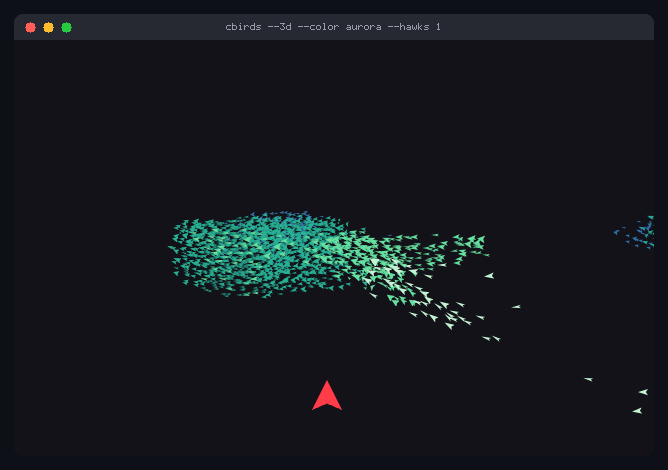<br>
<sub><b>Figure 1.</b> A murmuration in three dimensions (§3 to §5): 2000 birds over their roost, in aurora greens and blues, and a scarlet hawk through them. <code>cbirds --3d --color aurora --hawks 1</code></sub>
</p>

**Abstract.** cbirds draws a flock of birds in a terminal: in braille in any terminal, and as
real sprites over the Kitty graphics protocol [[4]](#references) in Kitty and Ghostty. Every
bird follows three local rules, the boids of Reynolds [[1]](#references): keep your distance,
fly the way your neighbours fly, drift towards their middle. Nothing in the code knows what a
flock looks like. With `--3d` the flock leaves the plane for a sky: each bird heeds its seven
nearest neighbours however far off they are, as starlings do [[2]](#references), and a roost
calls it home when it strays [[3]](#references). Any text piped in becomes a flock as well,
every letter a bird with a cell to come home to. This page writes the model down from the
code, with the numbers the code uses. Every figure on it was recorded by cbirds itself.

To run it: `brew install clainstone/tap/cbirds`, then `cbirds`. Other ways to install are in
[§11](#11-using-cbirds).

**Contents.**
[1 The flat flock](#1-the-flat-flock) &emsp;
[2 A predator](#2-a-predator) &emsp;
[3 Seven neighbours](#3-seven-neighbours) &emsp;
[4 A roost, and moving air](#4-a-roost-and-moving-air) &emsp;
[5 A camera](#5-a-camera) &emsp;
[6 Text as a flock](#6-text-as-a-flock) &emsp;
[7 One sky across terminals](#7-one-sky-across-terminals) &emsp;
[8 One frame](#8-one-frame) &emsp;
[9 Cost](#9-cost) &emsp;
[10 Methods](#10-methods) &emsp;
[11 Using cbirds](#11-using-cbirds) &emsp;
[References](#references)

## 1. The flat flock

Each bird $`i`$ has a position $`\mathbf{x}_i`$ in pixels and a heading $`\theta_i`$; write
$`\mathbf{u}(\theta) = (\cos\theta, \sin\theta)`$ for the unit vector it points along. A bird
sees the birds within its perception radius $`r`$ (the `perception` slider, 12 to 60 pixels,
36 by default), found through a grid of 12-pixel cells so that it reads only the cells
within reach:

```math
\mathcal{N}_i = \{\, j \neq i \;:\; \lVert \mathbf{x}_j - \mathbf{x}_i \rVert < r \,\}
```

From them it takes the three rules of Reynolds [[1]](#references), separation, alignment and
cohesion:

```math
\mathbf{s}_i = \sum_{j \in \mathcal{N}_i} (\mathbf{x}_i - \mathbf{x}_j), \qquad
\mathbf{a}_i = \frac{1}{|\mathcal{N}_i|} \sum_{j \in \mathcal{N}_i} \mathbf{u}(\theta_j), \qquad
\mathbf{c}_i = \frac{1}{|\mathcal{N}_i|} \sum_{j \in \mathcal{N}_i} \mathbf{x}_j \;-\; \mathbf{x}_i
\qquad (1)
```

and a push $`\mathbf{e}_i`$ away from the edges of the window. The edges have bands, a third of
the window wide on the sides and at the top and a sixth at the bottom; a bird that has
crossed a fraction $`\delta`$ of a band is pushed back with $`12 \delta^2`$, and harder still
past the edge, so that leaving is always possible and staying away never is ($`\mathbf{e}_i`$
also keeps the birds out of the panel's corner while the panel is open). The bird wants to fly
along the weighted sum

```math
\mathbf{F}_i = w_s\,\mathbf{s}_i + w_a\,\mathbf{a}_i + w_c\,\mathbf{c}_i + w_b\,\mathbf{e}_i + 4\,\mathbf{p}_i + 3\,\mathbf{h}_i,
\qquad \phi_i = \operatorname{atan2}(F_{i,y},\, F_{i,x})
\qquad (2)
```

with $`w_s = 0.005`$, $`w_a = 1.5`$, $`w_c = 0.01`$ and $`w_b = 0.2`$ at the default notches of the
`separation`, `alignment` and `boundary` sliders ($`w_c`$ has no slider), $`\mathbf{p}_i`$ the
pointer (a push away from it, falling to nothing 120 pixels off) and $`\mathbf{h}_i`$ the hawks
of §2. With several flocks, a sign or `--matrix`, a few more terms join the sum; a bird with
no neighbours keeps its heading, bent only by the terms that are not about neighbours. Then it
turns towards $`\phi_i`$, but only so far, and flies on:

```math
\theta_i \leftarrow \theta_i + \operatorname{clamp}\big(\operatorname{wrap}(\phi_i - \theta_i),\, -\Delta,\, \Delta\big),
\qquad \mathbf{x}_i \leftarrow \mathbf{x}_i + v\,\mathbf{u}(\theta_i)
\qquad (3)
```

where $`\operatorname{wrap}`$ takes an angle into $`(-\pi, \pi]`$. $`\Delta`$ is the `turning` slider,
70° by default: the most a bird turns in a sixtieth of a second at a pace of 1x. It is scaled
by the length of the frame and by the `speed` slider, which sets $`v`$ from 0.2x to 2.6x of the
tuned pace, so that a bird's turning circle is the same at any frame rate; at the top notch
the turn is instant. This one limit is what gives the flock curved fronts instead of a cloud
snapping into shape.

With several flocks (`--flocks`, 1 to 3), by default, separation counts every bird in reach,
while alignment and cohesion read only a bird's own flock, so flocks meet, cross and keep to
their own kind (Figure 2).

<p align="center">
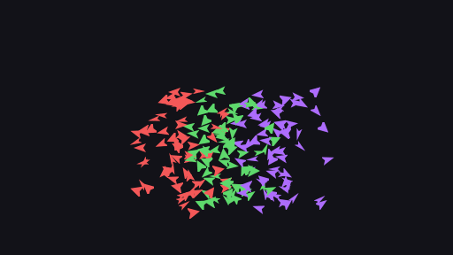<br>
<sub><b>Figure 2.</b> Three flocks under (1) to (3), each aligning with and drawn to its own kind only. <code>cbirds --render kitty --flocks 3 --color prism</code></sub>
</p>

## 2. A predator

A hawk is not a boid: it has no neighbours and follows none of the rules. It chases a bird,
and every bird within its reach $`R`$ (150 pixels, or a third of the window's shorter side if
that is less) flees it:

```math
\mathbf{h}_i = \sum_{k \,:\, d_{ik} < R} \Big(1 - \frac{d_{ik}}{R}\Big)\big(\hat{\mathbf{a}}_{ik} + 0.9\,\hat{\mathbf{n}}_{ik}\big)
\qquad (4)
```

where $`d_{ik}`$ is the distance from bird $`i`$ to hawk $`k`$, $`\hat{\mathbf{a}}_{ik}`$ the unit
vector away from the hawk, and $`\hat{\mathbf{n}}_{ik}`$ that vector turned a quarter turn
towards the side the bird is already heading. Straight away, and the flock would burst open
and be gone; with the sideways part it opens, streams past and closes behind. Figure 3 is
equation (4) as cbirds computes it, flying.

<p align="center">
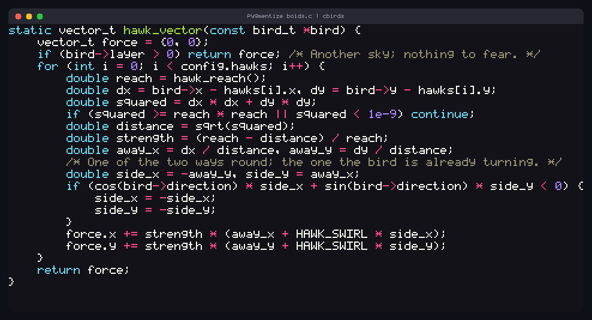<br>
<sub><b>Figure 3.</b> Equation (4) in C: <code>hawk_vector</code> from boids.c, piped into cbirds, takes flight letter by letter and lands back. <code>pygmentize boids.c | cbirds</code></sub>
</p>

## 3. Seven neighbours

`--3d` keeps the three rules and changes whom a bird heeds. Starlings in the field were found
to interact with a fixed number of neighbours rather than with all those within a fixed
distance: the interaction is topological, not metric [[2]](#references). In cbirds a bird
heeds its $`k`$ nearest birds whatever their distance, up to a limit of 12 m:

```math
\mathcal{N}_i = \{\text{the } k \text{ birds nearest to } i \text{, none further than } 12\ \mathrm{m}\}, \qquad k = 7
\qquad (5)
```

$`k`$ is the `neighbours` slider, 1 to 13, which takes the place of `perception`. Positions are
now in metres, with $`z`$ up and the roost at the origin, and a heading is a unit vector
$`\mathbf{h}_i`$, given by a yaw and a pitch. With $`d_{ij} = \lVert \mathbf{x}_j - \mathbf{x}_i \rVert`$
and $`\mathbf{m}_i`$ the mean offset from bird $`i`$ to its neighbours,

```math
\mathbf{a}_i = \frac{1}{|\mathcal{N}_i|}\sum_{j \in \mathcal{N}_i} \mathbf{h}_j, \qquad
\mathbf{c}_i = \frac{\mathbf{m}_i}{\lVert \mathbf{m}_i \rVert}\,\operatorname{clamp}\!\Big(\frac{\lVert \mathbf{m}_i \rVert - 0.5}{2.2},\, 0,\, 1\Big), \qquad
\mathbf{s}_i = \sum_{\substack{j \in \mathcal{N}_i \\ d_{ij} < 1.1}} \Big(1 - \frac{d_{ij}}{1.1}\Big)\frac{\mathbf{x}_i - \mathbf{x}_j}{d_{ij}}
\qquad (6)
```

Cohesion has nothing to say to a bird in the thick of its neighbours: only the part of the way
to their middle beyond half a metre counts, so it is the edge of a flock that is drawn in.
Separation pushes apart birds nearer than 1.1 m, hardest when they touch; the nearest
neighbour settles at about half a metre. Because a bird heeds its seven however far off they
are, the flock stays one body while its density rises and falls.

## 4. A roost, and moving air

There are no walls. A roost calls a bird home when it strays, sideways beyond 10 m of it and
up or down beyond 2 m of the height it likes, harder the further it has gone, as
Hildenbrandt, Carere and Hemelrijk modelled it [[3]](#references). With
$`\varrho_i = \sqrt{x_i^2 + y_i^2}`$ its distance from the roost across the ground,

```math
\mathbf{r}_i = -\frac{(x_i,\, y_i,\, 0)}{\varrho_i}\,\operatorname{clamp}\!\Big(\frac{\varrho_i - 10}{10},\, 0,\, 3\Big)
\;-\; \operatorname{sgn}(z_i)\,\operatorname{clamp}\!\Big(\frac{|z_i| - 2}{2},\, 0,\, 3\Big)\,\mathbf{e}_z
\qquad (7)
```

Those 2 m of height are why the flock is a sheet and not a ball, and so is a limit on pitch: a
bird may point at most 0.3 rad up or down, because a starling turns in the horizontal far more
freely than it climbs.

A flock pushed only by its neighbours and its roost settles into one plate that flies a loop
over the roost for ever. So the air over the roost moves. Each component of the current
$`\mathbf{w}`$ is a sum of slow travelling waves, longer than the flock:

```math
w(\mathbf{x}, t) = \sum_n a_n \sin\!\big(0.08\,\mathbf{d}_n \cdot \mathbf{x} \;-\; \omega_n t \;+\; \varphi_n\big)
\qquad (8)
```

two waves for each horizontal component and one weak one upward, with phases $`\varphi_n`$ that
depend on the seed. The front of the flock feels a different current from the back, so the
flock is stretched, folded, thinned and thickened as it flies, and where streams of birds draw
together are the dark knots. Each bird also has a restlessness of its own,
$`\boldsymbol{\eta}_i`$: a small random push with a memory of 1.4 s, half as strong upward.

All of it is summed into the way the bird wants to go:

```math
\mathbf{W}_i = \mathbf{h}_i + 5\,\mathbf{a}_i + 1.5\,\mathbf{c}_i + \mathbf{s}_i + 3\,\mathbf{r}_i
+ \mathbf{w}(\mathbf{x}_i, t) + 0.25\,\boldsymbol{\eta}_i + 12\,\mathbf{f}_i + 4\,\mathbf{q}_i
\qquad (9)
```

Unlike (2), the bird's own heading is in the sum. Alignment weighs most, because it is what
makes a flock one thing; the roost outweighs the air, so the air bends the flock and never
carries it off. $`\mathbf{f}_i`$ is the flight from hawks within 14 m, as in (4) with the
sideways part taken from the bird's own heading, and $`\mathbf{q}_i`$ is the pointer: a stick
poked into the sky along the line from the camera through it, and birds within 5 m of the line
get out of its way. The weights are those at the default notches; separation, alignment and
the roost follow their sliders.

The bird turns towards $`\mathbf{W}_i`$ at a limited rate a second, so it banks: its yaw by at
most $`\omega \Delta t`$ and its pitch by at most $`0.55 \omega \Delta t`$, where $`\omega`$ is the
`turning` slider, 70° a second by default and up to three times that with a hawk on it. It
leans into the turn as far as the turn is sharp, up to a bank $`\beta_i`$ of 0.95 rad, and its
speed eases towards

```math
v_i^{*} = 10\ \mathrm{m/s} \times \big(1 - 0.30\,h_{i,z} - 0.10\,|\beta_i| / 0.95\big)
\qquad (10)
```

so climbing costs speed, a dive gains it and a bank loses a little, which is how speed, and so
density, ripples through a flock when it turns. Then
$`\mathbf{x}_i \leftarrow \mathbf{x}_i + v_i \mathbf{h}_i \Delta t`$, in steps of at most a
thirtieth of a second.

<p align="center">
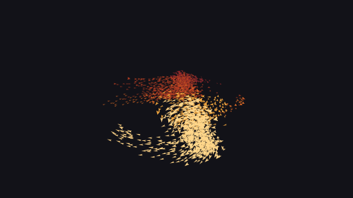<br>
<sub><b>Figure 4.</b> The roost and the air at work: an ember murmuration closes into a ring round a cyan hawk, then folds into arcs and sheets. <code>cbirds --3d --color ember --hawks 1</code></sub>
</p>

## 5. A camera

The camera goes once round the roost every two minutes, a little above the flock and rocking
slowly, so that the depth shows even in a still frame and the orbit is never quite a circle:

```math
\text{azimuth}(t) = 0.6 + 2\pi\,\frac{t}{120\ \mathrm{s}}, \qquad
\text{elevation}(t) = 0.34 + 0.20\,\sin\!\Big(2\pi\,\frac{t}{96\ \mathrm{s}}\Big)
\qquad (11)
```

It looks nine tenths of the way from the roost to the flock's middle and stands off 2.6 times
the flock's root mean square radius, quick to give a spreading flock room and slow to take it
back. A bird at $`\mathbf{x}`$, seen from the eye $`\mathbf{o}`$ along the camera's right, up and
forward axes $`\mathbf{r}`$, $`\mathbf{u}`$ and $`\mathbf{f}`$, lands on the screen at

```math
s_x = c_x + F\,\frac{(\mathbf{x}-\mathbf{o})\cdot\mathbf{r}}{(\mathbf{x}-\mathbf{o})\cdot\mathbf{f}}, \qquad
s_y = c_y - F\,\frac{(\mathbf{x}-\mathbf{o})\cdot\mathbf{u}}{(\mathbf{x}-\mathbf{o})\cdot\mathbf{f}}
\qquad (12)
```

with $`(c_x, c_y)`$ the middle of the window and $`F`$, the focal length, 0.72 of the picture's
size: a wide view, so that the near edge of a flock is a good deal nearer than the far one. A
bird's size goes as the camera's distance over the bird's depth, and it is drawn at one of
five sizes, from 0.62 to about 1.6 times `--size`, each with its own shade: a nearer bird is
bigger and brighter. A metre ahead of the bird and the span of its wings, projected the same
way, tell how much of its length and its span the camera sees: a bird flying at the camera is
short, one flying across it long.

<p align="center">
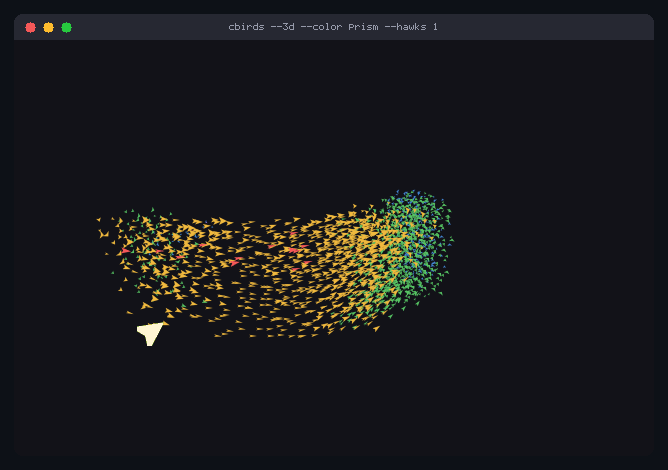<br>
<sub><b>Figure 5.</b> Depth in colour: in prism the colour runs through the flock with depth, red near to blue far, as a ribbon folds and bends round a hawk. <code>cbirds --3d --color prism --hawks 1</code></sub>
</p>

<p align="center">
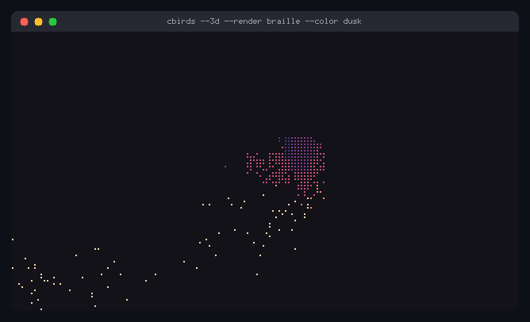<br>
<sub><b>Figure 6.</b> The same projection sampled down to braille dots, pink, violet and peach, as a terminal with no graphics protocol shows it. <code>cbirds --3d --render braille --color dusk</code></sub>
</p>

## 6. Text as a flock

Text piped into cbirds is read through a small terminal emulator of cbirds' own, so it opens
exactly as the command printed it, in its own colours (24-bit, 256 and the 16 colours), with
the layout of fastfetch and neofetch, the logo beside the information, kept. Every letter is a
bird whose home is the middle of its own cell. A few seconds later one letter leaves, the ones
near it follow, and the letters fly as a flock under (1) to (3). After twenty seconds or so
they are called home: a letter called home steers at its cell and its last step is exactly
the distance left, so every letter lands on its own cell and the screen is the text again.
Then it begins again.

<table>
<tr>
<td width="50%" align="center">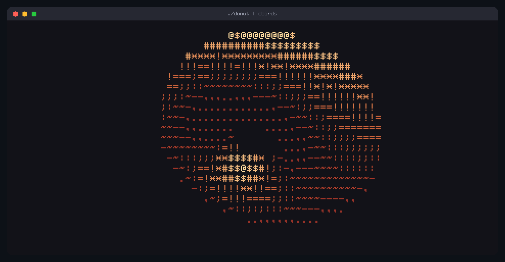<br><sub>(a) <code>./donut | cbirds</code></sub></td>
<td width="50%" align="center">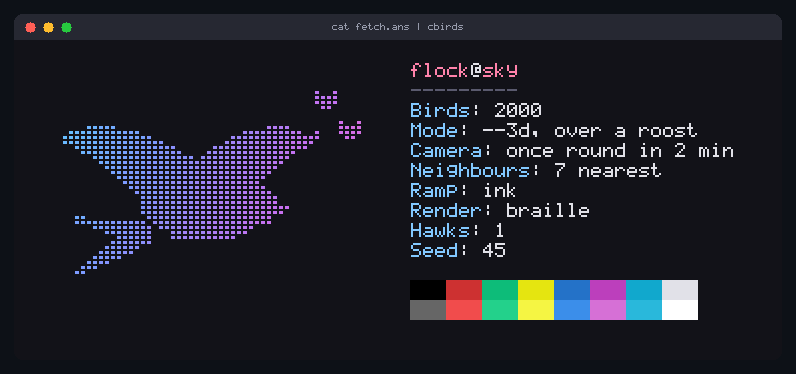<br><sub>(b) <code>cat docs/clips/fetch.ans | cbirds</code></sub></td>
</tr>
<tr>
<td align="center">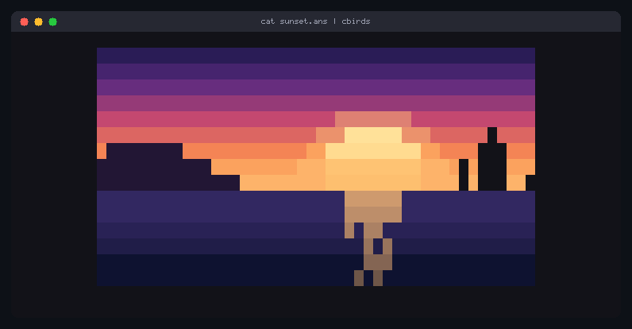<br><sub>(c) <code>cat docs/clips/sunset.ans | cbirds</code></sub></td>
<td align="center">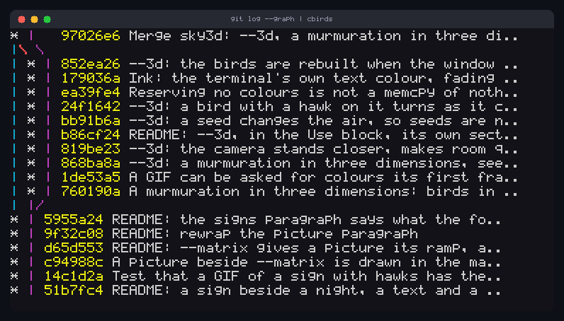<br><sub>(d) <code>git log --graph --color=always | cbirds</code></sub></td>
</tr>
</table>

<sub><b>Figure 7.</b> Any text is a flock. (a) One frame of a spinning donut, from
<a href="../../docs/clips/donut.c">docs/clips/donut.c</a>, after Andy Sloane's donut.c [5].
(b) A screen in the manner of fastfetch, made for the clip: the letters and the swallow's dots
fly, the colour blocks stay; <code>fastfetch | cbirds</code> does the same with yours. (c) A
picture drawn in █ characters, made for the clip, shatters into coloured pixels and is put back
exactly. (d) cbirds' own history, at the point where four feature tracks were merged. Each
recording runs a whole cycle, 34 s, and ends on the text as it was printed.</sub>

## 7. One sky across terminals

With `--link`, several windows share one sky. They lie in a row in the order they were
started, so start them left to right; only an edge with a window behind it is open, and the
outer edges are walls. A bird that flies out of the edge of one window flies in through
the edge of the next, at the same height and in the same direction, and hawks cross too. Each
window keeps its own settings (its own `--birds`, colours, renderer), and a sign goes with it.
The windows talk through Unix sockets in a directory that is yours alone
(`$XDG_RUNTIME_DIR/cbirds`, or `$TMPDIR/cbirds-UID`, or `/tmp/cbirds-UID`). `--link` is
refused with `--text`, text piped in, `--3d`, `--record` and `--bench`.

<p align="center">
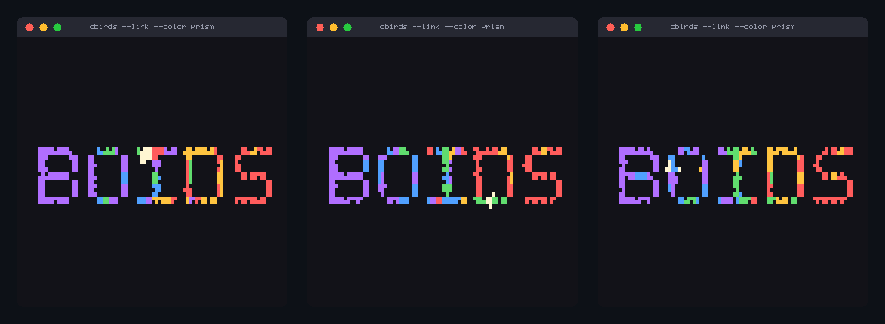<br>
<sub><b>Figure 8.</b> Three real windows, each running <code>cbirds --link --color prism --render sextants -n 220 -s 11 --hawks 1</code>, recorded through cbirds' own terminal emulator: the flock flows from one window into the next.</sub>
</p>

## 8. One frame

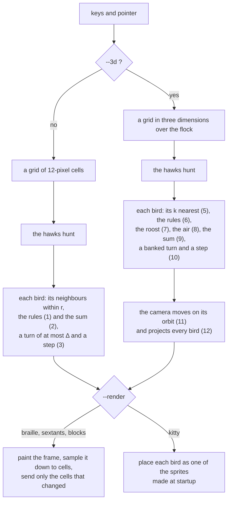

<sub><b>Figure 9.</b> One frame, at most sixty times a second. At startup the bird is rotated
into sixty headings, three wing positions and every shade of the ramp, about fifteen hundred
small images; the wings beat six times a second, and now and then a bird glides. The
background is never painted, so the flock wears your terminal's theme.</sub>

## 9. Cost

With sprites, 800 birds cost about half a millisecond of CPU a frame and 4000 about three;
braille, the default, about three and ten, since every frame is painted and sampled down to
dots. In 3D, 2000 birds cost about 3 ms a frame in braille and 1.7 ms with Kitty sprites,
measured on one desktop machine. `cbirds --bench 300` prints the numbers on yours. cbirds is
one program in C99 with no dependencies: the PNG, GIF and DEFLATE code is all in the
repository, and there is no zlib, no libpng, no ncurses.

## 10. Methods

Every clip in this repository was recorded by cbirds itself. `--record` needs no terminal: it
runs headless and writes the GIF with its own encoder, with sprites, or the cells with
`--render braille | sextants | blocks`; a name ending in `.cast` gives an asciinema recording.
`--seed N` gives the same flock on every system, because the random numbers are cbirds' own.

```
cbirds --record flock.gif --hawks 2 --seed 5
cbirds --record flock.cast --record-fps 30
cbirds --snapshot frame.png --frames 400
cbirds --3d --record murmuration.gif --color prism
```

`--record-size COLSxROWS` (40x14 to 400x120, default 96x26), `--record-fps` (a GIF carries up
to 50) and `--record-seconds` (default 6, 34 for text) set the shot, and `--snapshot FILE`
writes the last live frame as a PNG. The framed figures are the same frames inside a drawn
terminal window whose title bar names the command. The fetch screen and the sunset are texts
made for their clips; the donut, the code and the git log are the real output of the commands
named.

## 11. Using cbirds

Homebrew, on macOS and Linux:

```
brew install clainstone/tap/cbirds
```

<details>
<summary>apt, on Debian 12, Ubuntu 22.04 and later and their derivatives, amd64 or arm64</summary>

From [clainstone.com/apt](https://clainstone.com/apt):

```
sudo apt install curl
curl -fsSL https://clainstone.com/apt/cbirds.gpg | sudo tee /etc/apt/keyrings/cbirds.gpg >/dev/null
echo "deb [signed-by=/etc/apt/keyrings/cbirds.gpg] https://clainstone.com/apt stable main" | sudo tee /etc/apt/sources.list.d/cbirds.list
sudo apt update
sudo apt install cbirds
```

Homebrew and apt both come with completions for bash, zsh and fish; `brew upgrade` or
`sudo apt upgrade` keeps them up to date. The `.deb` files alone are on the
[release page](https://github.com/clainstone/cbirds/releases/latest).

</details>

<details>
<summary>From source, with a C compiler and make and nothing else (Linux and macOS)</summary>

```
git clone https://github.com/clainstone/cbirds
cd cbirds
make
sudo make install
cbirds
```

That installs one file, `/usr/local/bin/cbirds`; `make install PREFIX="$HOME/.local"` puts it
in your home. `make test` runs the tests.

</details>

<details>
<summary>Uninstall</summary>

```
brew uninstall cbirds
brew untap clainstone/tap
```

```
sudo apt remove cbirds
sudo rm /etc/apt/sources.list.d/cbirds.list /etc/apt/keyrings/cbirds.gpg
sudo apt update
```

From source: `sudo make uninstall` in the clone.

</details>

```
cbirds                              §1: the flock, in braille, in any terminal
cbirds --render kitty               sprites, in Kitty or Ghostty
cbirds --hawks 2 --color ice        §2: two hawks
cbirds --flocks 3 --color prism     Figure 2
cbirds --3d --hawks 1               §3 to §5: a murmuration, and a hawk through it
fastfetch | cbirds                  §6: the text is the flock
cbirds --link                       §7: in two terminals, started left to right
cbirds --preset murmuration         or swarm, or storm
cbirds --say "back in five"         the flock writes it and holds it as a sign
cbirds --clock --seconds            the time, to the second
cbirds --picture scene.png          the flock draws a PNG
cbirds --screensaver --clock        a lock screen that tells the time
```

The flock opens by writing BOIDS, lets go, and flocks. Move the pointer into it and it
scatters; `q` and it flies off the top. Left alone for a minute it starts moving the sliders
itself, a notch every four seconds, and any key ends that. `h` opens the panel, and `--panel`
opens it from the start: the sliders are the parameters of (1) to (3), boundary $`w_b`$,
separation $`w_s`$, alignment $`w_a`$, turning $`\Delta`$, perception $`r`$ and speed $`v`$ (0.2x to
2.6x), each 0 to 12 notches; lowercase lowers, uppercase raises. In 3D, `boundary` becomes
`roost` and `perception` becomes `neighbours`, the $`k`$ of (5).

| key | does | key | does |
|---|---|---|---|
| `b`/`B` `s`/`S` `a`/`A` `t`/`T` `p`/`P` `v`/`V` `g`/`G` | a slider one notch down / up | `h` | the panel |
| `Space` | pause | `.` | one frame |
| `0` | back to the defaults | `Tab` | next preset |
| `+` `-` | more birds, fewer | `k` `K` | a hawk more, one fewer |
| `e` | tails | `Enter` | letters off, or home (with text) |
| `q` | quit | | |

<details>
<summary>More: the options, signs, the lock screen, renderers</summary>

`-n/--birds` 1 to 4096 (default 800). `-s/--size` 4 to 64 pixels (default 30). `-g/--flocks`
1 to 3 flocks that keep to their own kind. `-k/--hawks` 0 to 4 predators: the flock parts
around them and closes behind. `--preset murmuration | swarm | storm`. `--seed N`: the same
flock on every system. `-c/--color`: theme (the terminal's own colours, asked of the
terminal), ember, ice, acid, matrix, aurora, prism, potion, dusk, ash, ink. `--shape bird |
arrow | plane | dot`. `--sprite FILE`: any PNG up to 4 MB, kept in its own colours. `--depth`:
a second sky further off (smaller, slower, dimmer birds). `-e/--trails`: faint tails.
`--matrix`: it is raining birds.

In 3D the defaults are 2000 birds, of 8 pixels (5 in the text renderers), in ink: a ramp from
your terminal's own text colour to its background, asked of the terminal at startup, so the
flock is grey on a dark terminal and near black on a light one. A terminal that does not
answer, or whose text is the colour of its ground, and every recording, get `ash`. `--color
ink` works in the flat sky as well. `--3d` replaces `--depth` and draws no tails; it is one
flock, so `--flocks` and `--matrix` are refused, and so are a text, a sign and `--link`. Every
renderer draws it, and `--screensaver`, the keys and recording go with it.

Text: `fastfetch | cbirds`, `git log --oneline --graph --color=always | cbirds`,
`figlet -f big hello | cbirds`, `cbirds --text poem.txt`. `--text -` reads standard input, and
a pipe with nothing in it gives the ordinary flock. `Enter` sends the letters off, or calls
them home at once; the pointer lifts the letters it touches; hawks work, and fly over text as
arrows.

Signs: `--say TEXT` writes TEXT and holds it for thirty to forty-five seconds, lets go, and
writes it again, while the rest of the flock wheels round the sign; `--font-size ROWS`, 4 to
10. `--clock` is the time, HH:MM, local time, and `--seconds` adds the seconds; at each new
minute only the digits that change let go and are written again. `--clock-at HH:MM[:SS]`
starts it at a time you choose. `--picture FILE` draws a PNG in at most eight of its colours,
or in a ramp if `--color` is given; `--shape dot -n 2000` draw it best. A key does not end a
sign, and birds scattered by the pointer or a hawk come back.

The lock screen: `--screensaver` quits at once on any key, click or pointer movement, with no
flight out (input in the first half second is ignored), and goes with everything else.

```
set -g lock-after-time 300
set -g lock-command "cbirds --screensaver --clock"
```

```
TMOUT=300
TRAPALRM() { cbirds --screensaver --clock }
```

Renderers: braille by default, in every terminal; no terminal is guessed at. `--render
sextants` and `--render blocks` are bolder text versions (sextants need a font from 2020 or
later; blocks work everywhere). Only the cells that changed are sent, and the background is
never painted, so the flock wears your theme. `--render kitty` draws real sprites over the
Kitty graphics protocol, made for Kitty and Ghostty. WezTerm, Konsole, iTerm2, Warp and Rio
answer for the protocol and then draw too few birds, the wrong ones or none; inside tmux the
sprites never reach the terminal.

The [manual](../../docs/manual.md) has the rest.

</details>

## References

1. Craig Reynolds. *Flocks, Herds, and Schools: A Distributed Behavioral Model*. SIGGRAPH 1987.
   [red3d.com/cwr/boids](https://www.red3d.com/cwr/boids/)
2. Ballerini et al. *Interaction ruling animal collective behavior depends on topological
   rather than metric distance: Evidence from a field study*. PNAS 2008.
3. Hildenbrandt, Carere and Hemelrijk. *Self-organized aerial displays of thousands of
   starlings: a model*. Behavioral Ecology 2010.
4. The Kitty graphics protocol.
   [sw.kovidgoyal.net/kitty/graphics-protocol](https://sw.kovidgoyal.net/kitty/graphics-protocol/)
5. Andy Sloane. donut.c, 2006. The donut in Figure 7(a) is after it.

## Credits

Much of cbirds' code, tests and documentation was written by large language models (Claude, by Anthropic), under my direction.

cbirds is listed in [Awesome CLI Apps](https://github.com/agarrharr/awesome-cli-apps#screensavers),
[Awesome TUIs](https://github.com/rothgar/awesome-tuis#screensavers) and
[Awesome Ricing](https://github.com/fosslife/awesome-ricing#show-off-scripts).

## Licence

MIT. See [LICENSE](../../LICENSE).
