<div align="center">

# cbirds

**A flock of birds in your terminal.** Every clip on this wall was recorded by cbirds itself; the command is under it.

</div>

<table>
  <tr>
    <td align="center" width="33%"><br><sub><code>./donut | cbirds</code></sub></td>
    <td align="center" width="33%"><br><sub><code>cat docs/clips/banner.ans | cbirds</code></sub></td>
    <td align="center" width="33%"><br><sub><code>cat docs/clips/sunset.ans | cbirds</code></sub></td>
  </tr>
  <tr>
    <td align="center"><br><sub><code>cbirds --3d --color prism --hawks 1</code></sub></td>
    <td align="center"><br><sub><code>cbirds --3d --color aurora --hawks 1</code></sub></td>
    <td align="center"><br><sub><code>cbirds --3d --render braille --color dusk</code></sub></td>
  </tr>
  <tr>
    <td align="center" colspan="3"><br><sub>three real windows, <code>cbirds --link --color prism --render sextants -n 220 -s 11 --hawks 1</code> in each, recorded through cbirds' own terminal emulator</sub></td>
  </tr>
  <tr>
    <td align="center"><br><sub><code>pygmentize boids.c | cbirds</code></sub></td>
    <td align="center"><br><sub><code>cat docs/clips/fetch.ans | cbirds</code></sub></td>
    <td align="center"><br><sub><code>git log --graph --color=always | cbirds</code></sub></td>
  </tr>
  <tr>
    <td align="center"><br><sub><code>cbirds --3d --color ember --hawks 1</code></sub></td>
    <td align="center">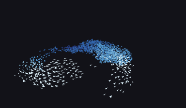<br><sub><code>cbirds --3d --color ice --hawks 1</code></sub></td>
    <td align="center">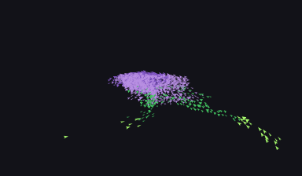<br><sub><code>cbirds --3d --color potion --hawks 1</code></sub></td>
  </tr>
  <tr>
    <td align="center">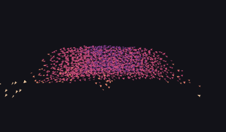<br><sub><code>cbirds --3d --color dusk --hawks 1</code></sub></td>
    <td align="center">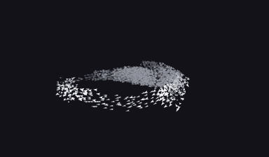<br><sub><code>cbirds --3d --color ash --hawks 1</code></sub></td>
    <td align="center">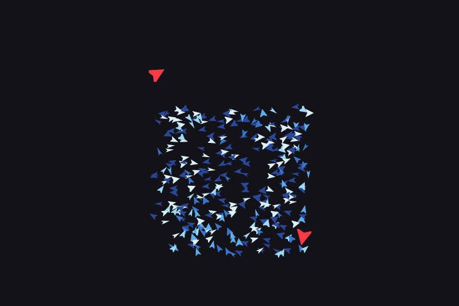<br><sub><code>cbirds --render kitty --hawks 2 --color ice --speed 0 -n 300 -s 14</code></sub></td>
  </tr>
  <tr>
    <td align="center"><br><sub><code>cbirds --render kitty --hawks 2 --color ice --speed 0</code></sub></td>
    <td align="center"><br><sub><code>cbirds --render kitty --flocks 3 --color prism</code></sub></td>
    <td align="center">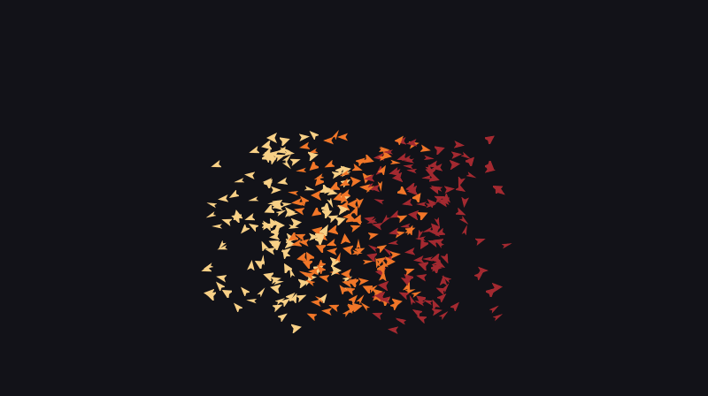<br><sub><code>cbirds --flocks 3 --color ember</code></sub></td>
  </tr>
  <tr>
    <td align="center">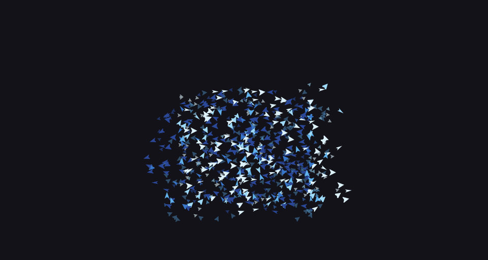<br><sub><code>cbirds --depth --trails --color ice</code></sub></td>
    <td align="center">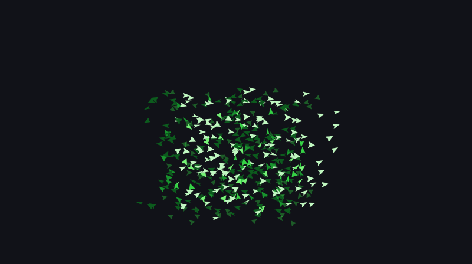<br><sub><code>cbirds --matrix</code></sub></td>
    <td align="center">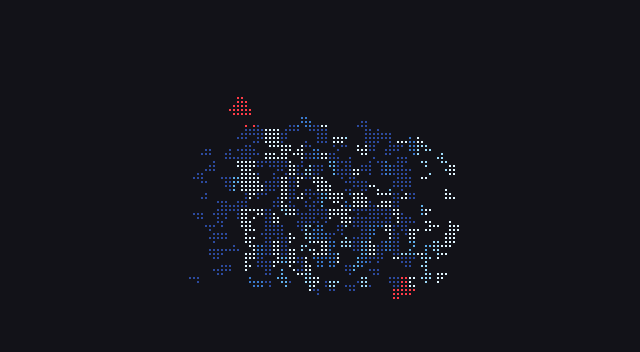<br><sub><code>cbirds --hawks 2 --color ice</code></sub></td>
  </tr>
  <tr>
    <td align="center">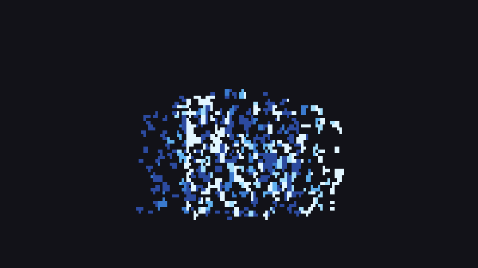<br><sub><code>cbirds --render sextants --color acid</code></sub></td>
    <td align="center"><br><sub><code>cbirds --preset murmuration --color dusk</code></sub></td>
    <td align="center"><br><sub><code>cat docs/neofetch.txt | cbirds</code></sub></td>
  </tr>
  <tr>
    <td align="center">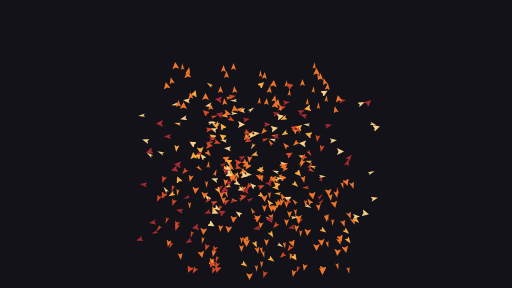<br><sub><code>cbirds --say "back in five"</code></sub></td>
    <td align="center"><br><sub><code>cbirds --clock-at 10:09:52</code></sub></td>
    <td align="center"><br><sub><code>cbirds --picture docs/scene.png --shape dot -n 1500 -s 16</code></sub></td>
  </tr>
</table>

Craig Reynolds' boids, drawn in braille in any terminal, and as real sprites
over the Kitty graphics protocol in Kitty and Ghostty. Pipe text in and the text
is the flock. `--3d` lifts it into a sky of 2000 birds over a roost; `--link`
makes several terminals one sky. One program in C99, no dependencies, for Linux
and macOS.

## Install

Homebrew, on macOS and Linux:

```
brew install clainstone/tap/cbirds
```

Homebrew and apt both come with completions for bash, zsh and fish;
`brew upgrade` or `sudo apt upgrade` keeps them up to date.

<details>
<summary><b>apt</b>, on Debian 12, Ubuntu 22.04 and later and their derivatives</summary>

On amd64 or arm64, from [clainstone.com/apt](https://clainstone.com/apt):

```
sudo apt install curl
curl -fsSL https://clainstone.com/apt/cbirds.gpg | sudo tee /etc/apt/keyrings/cbirds.gpg >/dev/null
echo "deb [signed-by=/etc/apt/keyrings/cbirds.gpg] https://clainstone.com/apt stable main" | sudo tee /etc/apt/sources.list.d/cbirds.list
sudo apt update
sudo apt install cbirds
```

The .deb files alone are on the
[release page](https://github.com/clainstone/cbirds/releases/latest).

</details>

<details>
<summary><b>From source</b>, with a C compiler and make and nothing else</summary>

```
git clone https://github.com/clainstone/cbirds
cd cbirds
make
sudo make install
cbirds
```

That installs one file, `/usr/local/bin/cbirds`; `make install PREFIX="$HOME/.local"`
puts it in your home. `make test` runs the tests.

</details>

<details>
<summary><b>Uninstall</b></summary>

```
brew uninstall cbirds
brew untap clainstone/tap
```

```
sudo apt remove cbirds
sudo rm /etc/apt/sources.list.d/cbirds.list /etc/apt/keyrings/cbirds.gpg
sudo apt update
```

From source: `sudo make uninstall` in the clone.

</details>

## Behind the wall

<details>
<summary><b>Anything can fly</b>: pipe text in, and every letter is a bird</summary>

```
fastfetch | cbirds
git log --oneline --graph --color=always | cbirds
figlet -f big hello | cbirds
cbirds --text poem.txt
```

It opens with the text exactly as the command printed it, in its own colours
(24-bit, 256 and the 16). fastfetch's and neofetch's layout, with the logo
beside the information, is kept, because cbirds reads the output through a small
terminal emulator of its own. A few seconds later one letter leaves, the ones
near it follow, and the letters fly as a flock. After twenty seconds or so they
are called home, and every letter lands on its own cell, exactly. Then it begins
again.

`Enter` sends the letters off, or calls them home at once. The pointer lifts the
letters it touches. Hawks work, and fly over text as arrows. `--text FILE` reads
a file; `--text -` reads standard input. A pipe with nothing in it gives the
ordinary flock.

On the wall: the donut, the code and the git log are the real output of the
commands under them; the donut is [docs/clips/donut.c](../../docs/clips/donut.c),
after Andy Sloane's donut.c. The banner, the sunset and the fetch screen are
texts made for the clips (`banner.ans`, `sunset.ans` and `fetch.ans` in
`docs/clips`); `fastfetch | cbirds` does the same with your own fetch screen.
More in the [manual](../../docs/manual.md#anything-can-fly).

</details>

<details>
<summary><b>Three dimensions</b>: <code>--3d</code>, a murmuration of 2000 birds over its roost</summary>

The flock leaves the plane for a sky: a murmuration of 2000 birds over its
roost, seen from a camera that goes once round it every two minutes, so the
depth shows even in a still frame. A nearer bird is bigger and brighter; a bird
flying at the camera is short, one flying across it long.

The same three rules, but a bird heeds its seven nearest neighbours however far
off they are, as starlings do (Ballerini et al., PNAS 2008), rather than
everything within a radius. It turns at a limited rate a second, so it banks. A
roost calls it home when it strays and the air above the roost moves slowly,
which folds the flock into sheets and ribbons (Hildenbrandt, Carere and
Hemelrijk, Behavioral Ecology 2010).

The defaults are 2000 birds, of 8 pixels (5 in the text renderers), in **ink**: a
ramp from your terminal's own text colour to its background, asked of the
terminal at startup, so the flock is grey on a dark terminal and near black on a
light one. A terminal that does not answer, or whose text is the colour of its
ground, and every recording, get `ash`, the greys on the wall. `--color ink`
works in the flat sky as well. Any other ramp can be asked for:
`cbirds --3d --color prism`.

Hawks hunt the flock through the air (`--hawks`, `k`/`K`). The pointer is a stick
poked into the sky: birds near the line from the camera through it get out of
the way. In the panel `boundary` becomes `roost` and `perception` becomes
`neighbours` (1 to 13). Every renderer draws it: braille, sextants, blocks,
Kitty sprites. `--screensaver` goes with it, and so do the keys and recording.

It replaces `--depth` and draws no tails; one flock: `--flocks` and `--matrix`
are refused, and so are a text, a sign and `--link`.

</details>

<details>
<summary><b>One sky</b>: <code>--link</code>, several terminals become one sky</summary>

```
cbirds --link        # in one terminal
cbirds --link        # in another
```

Birds that fly out of the edge of one window fly in through the edge of the
next, at the same height and in the same direction; hawks cross too. Two
terminals side by side, or two panes of a split, become one sky.

The windows lie in a row in the order they were started: start them left to
right. Only an edge with a window behind it is open; the outer edges are walls.
Each window keeps its own settings (its own `--birds`, colours, renderer). A sign
goes with it; so does `--screensaver`.

The windows talk through Unix sockets in a directory that is yours alone
(`$XDG_RUNTIME_DIR/cbirds`, or `$TMPDIR/cbirds-UID`, or `/tmp/cbirds-UID`).
`--link` is refused with `--text`, text piped in, `--3d`, `--record` and
`--bench`. More in the [manual](../../docs/manual.md#one-sky-several-terminals).

</details>

<details>
<summary><b>The flock</b>: three rules, hawks, flocks, ramps and shapes</summary>

It opens by writing BOIDS, lets go, and flocks. Move the pointer into the flock
and it scatters. `q` and it flies off the top. Left alone for a minute it starts
moving the sliders itself, a notch every four seconds; any key ends that.

The three rules: keep your distance, fly the way your neighbours fly, drift
towards their middle; plus a nudge away from the edges. Turning is limited per
frame, which gives curved fronts instead of a cloud snapping into shape.

| option | |
|---|---|
| `-n`, `--birds` | 1 to 4096 (default 800) |
| `-s`, `--size` | 4 to 64 pixels (default 30) |
| `-g`, `--flocks` | 1 to 3 flocks that keep to their own kind |
| `-k`, `--hawks` | 0 to 4 predators: the flock parts around them and closes behind |
| `--preset` | `murmuration`, `swarm` or `storm` |
| `--seed N` | the same flock on every system (cbirds' own random numbers) |
| `-c`, `--color` | `theme` (the terminal's own colours, asked of the terminal), `ember`, `ice`, `acid`, `matrix`, `aurora`, `prism`, `potion`, `dusk`, `ash`, `ink` |
| `--shape` | `bird`, `arrow`, `plane` or `dot` |
| `--sprite FILE` | any PNG up to 4 MB, kept in its own colours |
| `--depth` | a second sky further off: smaller, slower, dimmer birds |
| `-e`, `--trails` | faint tails |
| `--matrix` | it is raining birds: green, falling, with tails |

</details>

<details>
<summary><b>Keys and the panel</b></summary>

The panel (`h`, or `--panel` from the start) has sliders for boundary,
separation, alignment, turning, perception and speed (0.2x to 2.6x), each 0 to
12 notches; lowercase lowers, uppercase raises. More in the
[manual](../../docs/manual.md#the-panel).

| key | does |
|---|---|
| `b`/`B` `s`/`S` `a`/`A` `t`/`T` `p`/`P` `v`/`V` `g`/`G` | a slider one notch down / up |
| `h` | the panel |
| `Space` | pause |
| `.` | one frame |
| `0` | back to the defaults |
| `Tab` | next preset |
| `+` `-` | more birds, fewer |
| `k` `K` | a hawk more, one fewer |
| `e` | tails |
| `Enter` | letters off, or home (with text) |
| `q` | quit |

</details>

<details>
<summary><b>Signs, the clock and pictures</b>: <code>--say</code>, <code>--clock</code>, <code>--picture</code></summary>

`--say TEXT`: the flock writes TEXT and holds it as a sign for thirty to
forty-five seconds, lets go, and writes it again; the rest of the flock wheels
round the sign. `--font-size ROWS`, 4 to 10.

`--clock`: the time, HH:MM, local time; `--seconds` adds the seconds. At each new
minute only the digits that change let go and are written again.
`--clock-at HH:MM[:SS]` starts it at a time you choose.

`--picture FILE`: the flock draws a PNG, in at most eight of its colours, or in a
ramp if `--color` is given. `--shape dot -n 2000` draw it best.

A key does not end a sign; birds scattered by the pointer or a hawk come back.
More in the [manual](../../docs/manual.md#signs-the-clock-and-pictures).

</details>

<details>
<summary><b>Screensaver</b>: <code>--screensaver</code>, in tmux or zsh</summary>

`--screensaver` quits at once on any key, click or pointer movement, with no
flight out (input in the first half second is ignored). It goes with everything
else. In tmux:

```
set -g lock-after-time 300
set -g lock-command "cbirds --screensaver --clock"
```

In zsh:

```
TMOUT=300
TRAPALRM() { cbirds --screensaver --clock }
```

</details>

<details>
<summary><b>Terminals</b>: braille everywhere, sprites in Kitty and Ghostty</summary>

Braille by default, in every terminal; no terminal is guessed at.
`--render sextants` and `--render blocks` are bolder text versions (sextants need
a font from 2020 or later; blocks work everywhere). Only the cells that changed
are sent, and the background is never painted, so the flock wears your theme.

`--render kitty` draws real sprites over the Kitty graphics protocol, made for
Kitty and Ghostty. WezTerm, Konsole, iTerm2, Warp and Rio answer for the protocol
and then draw too few birds, the wrong ones or none; inside tmux the sprites
never reach the terminal.

</details>

<details>
<summary><b>Recording</b>: GIFs and casts, written by cbirds itself</summary>

```
cbirds --record flock.gif --hawks 2 --seed 5
cbirds --record flock.cast --record-fps 30
cbirds --snapshot frame.png --frames 400
cbirds --3d --record murmuration.gif --color prism
```

`--record` needs no terminal: it runs headless and writes the GIF with its own
encoder (sprites, or the cells with `--render braille | sextants | blocks`). A
name ending in `.cast` gives an asciinema recording. `--record-size COLSxROWS`
(40x14 to 400x120, default 96x26), `--record-fps` (a GIF carries up to 50),
`--record-seconds` (default 6, 34 for text). A recording of text runs a whole
cycle, 34 seconds, unless told otherwise, and ends on the text as it was
printed. `--snapshot FILE` writes the last live frame as a PNG.

Every clip in this repository was recorded by cbirds itself. The commands behind
the older clips are in [docs/README.md](../../docs/README.md).

</details>

<details>
<summary><b>Numbers</b>: what a frame costs</summary>

With sprites, 800 birds cost about half a millisecond of CPU a frame and 4000
about three; braille, the default, about three and ten, since every frame is
painted and sampled down to dots. In 3D, 2000 birds cost about 3 ms a frame in
braille and 1.7 ms with Kitty sprites, measured on one desktop machine.
`cbirds --bench 300` prints the numbers on yours.

At startup the bird is rotated into sixty headings, three wing positions and
every shade of the ramp: about fifteen hundred small images. The wings beat six
times a second, and now and then a bird glides. The PNG, GIF and DEFLATE code is
all in the repository; there is no zlib, no libpng, no ncurses.

</details>

## Credits

Much of cbirds' code, tests and documentation was written by large language
models (Claude, by Anthropic), under my direction.

- Craig Reynolds, *Flocks, Herds, and Schools: A Distributed Behavioral Model*,
  SIGGRAPH 1987; [red3d.com/cwr/boids](https://www.red3d.com/cwr/boids/)
- Ballerini et al., *Interaction ruling animal collective behavior depends on
  topological rather than metric distance: Evidence from a field study*, PNAS 2008.
- Hildenbrandt, Carere and Hemelrijk, *Self-organized aerial displays of
  thousands of starlings: a model*, Behavioral Ecology 2010.
- The Kitty graphics protocol:
  [sw.kovidgoyal.net/kitty/graphics-protocol](https://sw.kovidgoyal.net/kitty/graphics-protocol/)
- The donut in the donut clip is after Andy Sloane's donut.c (2006).

Listed in [Awesome CLI Apps](https://github.com/agarrharr/awesome-cli-apps#screensavers),
[Awesome TUIs](https://github.com/rothgar/awesome-tuis#screensavers) and
[Awesome Ricing](https://github.com/fosslife/awesome-ricing#show-off-scripts).

## Licence

MIT, by Alessandro Palliccia ([clainstone](https://github.com/clainstone)). See
[LICENSE](../../LICENSE).
