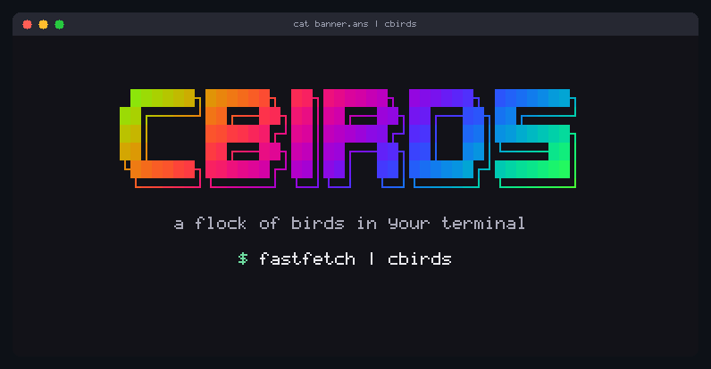

```
                  ██████╗██████╗ ██╗██████╗ ██████╗ ███████╗
                 ██╔════╝██╔══██╗██║██╔══██╗██╔══██╗██╔════╝
                 ██║     ██████╔╝██║██████╔╝██║  ██║███████╗
                 ██║     ██╔══██╗██║██╔══██╗██║  ██║╚════██║
                 ╚██████╗██████╔╝██║██║  ██║██████╔╝███████║
                  ╚═════╝╚═════╝ ╚═╝╚═╝  ╚═╝╚═════╝ ╚══════╝

                      a flock of birds in your terminal

   ░▒▓█  C99  █▓▒░  NO DEPENDENCIES  ░▒▓█  LINUX AND MACOS  █▓▒░  MIT  ░▒▓█
```

<p align="center">
  <br>
  <sub>the same letters in colour, piped in: <code>cat docs/clips/banner.ans | cbirds</code>, a banner made for the clip</sub>
</p>

<p align="center">
  <a href="#anything-can-fly"><kbd>01</kbd> fly</a>&ensp;
  <a href="#three-dimensions"><kbd>02</kbd> 3d</a>&ensp;
  <a href="#one-sky"><kbd>03</kbd> one sky</a>&ensp;
  <a href="#install"><kbd>04</kbd> install</a>&ensp;
  <a href="#the-flock"><kbd>05</kbd> flock</a>&ensp;
  <a href="#keys"><kbd>06</kbd> keys</a>&ensp;
  <a href="#signs"><kbd>07</kbd> signs</a>&ensp;
  <a href="#screensaver"><kbd>08</kbd> screensaver</a>&ensp;
  <a href="#terminals"><kbd>09</kbd> terminals</a>&ensp;
  <a href="#recording"><kbd>10</kbd> recording</a>&ensp;
  <a href="#inside"><kbd>11</kbd> inside</a>&ensp;
  <a href="#credits"><kbd>12</kbd> credits</a>
</p>

Craig Reynolds' boids, drawn in braille in any terminal, and as real sprites
over the Kitty graphics protocol in Kitty and Ghostty. Anything a terminal
prints can join the flock.

<a name="anything-can-fly"></a>

```
╔══[ 01 ]════════════════════════════════════════════════════════════════════╗
║  ANYTHING CAN FLY                                  ░▒▓ text, piped in ▓▒░  ║
╚════════════════════════════════════════════════════════════════════════════╝
```

Pipe text into cbirds and the text is the flock: every letter is a bird. It
opens with the text exactly as the command printed it, in its own colours,
24-bit, 256 and the 16. fastfetch's and neofetch's layout, with the logo beside
the information, is kept, because cbirds reads the output through a small
terminal emulator of its own.

```
fastfetch | cbirds
git log --oneline --graph --color=always | cbirds
figlet -f big hello | cbirds
cbirds --text poem.txt
```

<p align="center">
  <br>
  <sub><code>cat docs/clips/sunset.ans | cbirds</code>&ensp;a picture drawn in █ characters, made for the clip</sub>
</p>

<table>
  <tr>
    <td align="center" width="50%"></td>
    <td align="center" width="50%"></td>
  </tr>
  <tr>
    <td align="center"><sub><code>./donut | cbirds</code><br><a href="../../docs/clips/donut.c">docs/clips/donut.c</a>, after Andy Sloane's donut.c</sub></td>
    <td align="center"><sub><code>pygmentize boids.c | cbirds</code><br>cbirds reading its own code</sub></td>
  </tr>
  <tr>
    <td align="center"></td>
    <td align="center"></td>
  </tr>
  <tr>
    <td align="center"><sub><code>cat docs/clips/fetch.ans | cbirds</code><br>a screen in the manner of fastfetch; <code>fastfetch | cbirds</code> does the same with yours</sub></td>
    <td align="center"><sub><code>git log --graph --color=always | cbirds</code><br>cbirds' own history, where four feature tracks were merged</sub></td>
  </tr>
</table>

A few seconds later one letter leaves, the ones near it follow, and the letters
fly as a flock. After twenty seconds or so they are called home, and every
letter lands on its own cell, exactly. Then it begins again. <kbd>Enter</kbd>
sends the letters off, or calls them home at once; the pointer lifts the letters
it touches; hawks work, and fly over text as arrows. `--text FILE` reads a file,
`--text -` reads standard input, and a pipe with nothing in it gives the
ordinary flock. More in the [manual](../../docs/manual.md#anything-can-fly).

<a name="three-dimensions"></a>

```
╔══[ 02 ]════════════════════════════════════════════════════════════════════╗
║  THREE DIMENSIONS                                            ░▒▓ --3d ▓▒░  ║
╚════════════════════════════════════════════════════════════════════════════╝
```

<p align="center">
  <br>
  <sub><code>cbirds --3d --color prism --hawks 1</code></sub>
</p>

The flock leaves the plane for a sky: a murmuration of 2000 birds over its
roost, seen from a camera that goes once round it every two minutes, so the
depth shows even in a still frame. A nearer bird is bigger and brighter; a bird
flying at the camera is short, one flying across it long.

The same three rules, but a bird heeds its seven nearest neighbours however far
off they are, as starlings do (Ballerini et al., PNAS 2008), rather than
everything within a radius. It turns at a limited rate a second, so it banks. A
roost calls it home when it strays and the air above the roost moves slowly,
which folds the flock into sheets and ribbons (Hildenbrandt, Carere and
Hemelrijk, Behavioral Ecology 2010).

<table>
  <tr>
    <td align="center" width="50%"></td>
    <td align="center" width="50%"></td>
  </tr>
  <tr>
    <td align="center"><sub><code>cbirds --3d --color aurora --hawks 1</code></sub></td>
    <td align="center"><sub><code>cbirds --3d --render braille --color dusk</code><br>as a terminal with no graphics protocol shows it</sub></td>
  </tr>
</table>

By default: 2000 birds, of 8 pixels (5 in the text renderers), in `ink`, a ramp
from your terminal's own text colour to its background, asked of the terminal at
startup, so the flock is grey on a dark terminal and near black on a light one.
A terminal that does not answer, or whose text is the colour of its ground, and
every recording, get `ash`. `--color ink` works in the flat sky as well, and any
other ramp can be asked for: `cbirds --3d --color prism`.

Hawks hunt the flock through the air (`--hawks`, <kbd>k</kbd>/<kbd>K</kbd>).
The pointer is a stick poked into the sky: birds near the line from the camera
through it get out of the way. In the panel `boundary` becomes `roost` and
`perception` becomes `neighbours` (1 to 13). Every renderer draws it: braille,
sextants, blocks, Kitty sprites. `--screensaver` goes with it, and so do the
keys and recording. It replaces `--depth` and draws no tails; one flock:
`--flocks` and `--matrix` are refused, and so are a text, a sign and `--link`.

<a name="one-sky"></a>

```
╔══[ 03 ]════════════════════════════════════════════════════════════════════╗
║  ONE SKY, SEVERAL TERMINALS                                ░▒▓ --link ▓▒░  ║
╚════════════════════════════════════════════════════════════════════════════╝
```

<p align="center">
  <br>
  <sub>three real windows, <code>cbirds --link --color prism --render sextants -n 220 -s 11 --hawks 1</code> in each, recorded through cbirds' own terminal emulator</sub>
</p>

```
cbirds --link        # in one terminal
cbirds --link        # in another
```

Birds that fly out of the edge of one window fly in through the edge of the
next, at the same height and in the same direction; hawks cross too. Two
terminals side by side, or two panes of a split, become one sky. The windows lie
in a row in the order they were started, so start them left to right. Only an
edge with a window behind it is open; the outer edges are walls.

```
      started 1st                started 2nd                started 3rd
┌──────────────────────┐   ┌──────────────────────┐   ┌──────────────────────┐
█                      ┊   ┊                      ┊   ┊                      █
█         > >> >>> >>>>┊   ┊>>>>> >> >            ┊   ┊                      █
█                      ┊   ┊             <<<< << <┊   ┊<<<< <<< << <         █
█                      ┊   ┊                      ┊   ┊                      █
└──────────────────────┘   └──────────────────────┘   └──────────────────────┘
    █ wall: the outer edges        ┊ open: an edge with a window behind it
```

Each window keeps its own settings, its own `--birds`, colours and renderer. A
sign goes with it, and so does `--screensaver`. The windows talk through Unix
sockets in a directory that is yours alone: `$XDG_RUNTIME_DIR/cbirds`, or
`$TMPDIR/cbirds-UID`, or `/tmp/cbirds-UID`. `--link` is refused with `--text`,
text piped in, `--3d`, `--record` and `--bench`. More in the
[manual](../../docs/manual.md#one-sky-several-terminals).

<a name="install"></a>

```
╔══[ 04 ]════════════════════════════════════════════════════════════════════╗
║  INSTALL                                        ░▒▓ brew, apt, source ▓▒░  ║
╚════════════════════════════════════════════════════════════════════════════╝
```

Homebrew, on macOS and Linux:

```
brew install clainstone/tap/cbirds
```

apt, on Debian 12, Ubuntu 22.04 and later and their derivatives, amd64 or arm64,
from [clainstone.com/apt](https://clainstone.com/apt):

```
sudo apt install curl
curl -fsSL https://clainstone.com/apt/cbirds.gpg | sudo tee /etc/apt/keyrings/cbirds.gpg >/dev/null
echo "deb [signed-by=/etc/apt/keyrings/cbirds.gpg] https://clainstone.com/apt stable main" | sudo tee /etc/apt/sources.list.d/cbirds.list
sudo apt update
sudo apt install cbirds
```

Both come with completions for bash, zsh and fish; `brew upgrade` /
`sudo apt upgrade` keep them up to date. The .deb files alone are on the
[release page](https://github.com/clainstone/cbirds/releases/latest).

From source, with a C compiler and make and nothing else:

```
git clone https://github.com/clainstone/cbirds
cd cbirds
make
sudo make install
cbirds
```

That installs one file, `/usr/local/bin/cbirds`; `make install PREFIX="$HOME/.local"`
puts it in your home. `make test` runs the tests.

<details>
<summary>Uninstall</summary>

```
brew uninstall cbirds
brew untap clainstone/tap
```

```
sudo apt remove cbirds
sudo rm /etc/apt/sources.list.d/cbirds.list /etc/apt/keyrings/cbirds.gpg
sudo apt update
```

From source: `sudo make uninstall` in the clone.

</details>

<a name="the-flock"></a>

```
╔══[ 05 ]════════════════════════════════════════════════════════════════════╗
║  THE FLOCK                                            ░▒▓ three rules ▓▒░  ║
╚════════════════════════════════════════════════════════════════════════════╝
```

It opens by writing BOIDS, lets go, and flocks. Move the pointer into the flock
and it scatters. <kbd>q</kbd> and it flies off the top. Left alone for a minute
it starts moving the sliders itself, a notch every four seconds; any key ends
that.

The three rules: keep your distance, fly the way your neighbours fly, drift
towards their middle; plus a nudge away from the edges. Turning is limited per
frame, which gives curved fronts instead of a cloud snapping into shape.

| option | |
|---|---|
| `-n`, `--birds` | 1 to 4096 (default 800) |
| `-s`, `--size` | 4 to 64 pixels (default 30) |
| `-g`, `--flocks` | 1 to 3 flocks that keep to their own kind |
| `-k`, `--hawks` | 0 to 4 predators: the flock parts around them and closes behind |
| `--preset` | `murmuration`, `swarm` or `storm` |
| `--seed N` | the same flock on every system (cbirds' own random numbers) |
| `-c`, `--color` | `theme` (the terminal's own colours, asked of the terminal), `ember`, `ice`, `acid`, `matrix`, `aurora`, `prism`, `potion`, `dusk`, `ash`, `ink` |
| `--shape` | `bird`, `arrow`, `plane` or `dot` |
| `--sprite FILE` | any PNG up to 4 MB, kept in its own colours |
| `--depth` | a second sky further off: smaller, slower, dimmer birds |
| `-e`, `--trails` | faint tails |
| `--matrix` | it is raining birds: green, falling, with tails |

<a name="keys"></a>

```
╔══[ 06 ]════════════════════════════════════════════════════════════════════╗
║  KEYS AND THE PANEL                                       ░▒▓ press h ▓▒░  ║
╚════════════════════════════════════════════════════════════════════════════╝
```

| key | does |
|---|---|
| <kbd>b</kbd> <kbd>s</kbd> <kbd>a</kbd> <kbd>t</kbd> <kbd>p</kbd> <kbd>v</kbd> <kbd>g</kbd> | a slider one notch down |
| <kbd>B</kbd> <kbd>S</kbd> <kbd>A</kbd> <kbd>T</kbd> <kbd>P</kbd> <kbd>V</kbd> <kbd>G</kbd> | a slider one notch up |
| <kbd>h</kbd> | the panel |
| <kbd>Space</kbd> | pause |
| <kbd>.</kbd> | one frame |
| <kbd>0</kbd> | back to the defaults |
| <kbd>Tab</kbd> | next preset |
| <kbd>+</kbd> <kbd>-</kbd> | more birds, fewer |
| <kbd>k</kbd> <kbd>K</kbd> | a hawk more, one fewer |
| <kbd>e</kbd> | tails |
| <kbd>Enter</kbd> | letters off, or home (with text) |
| <kbd>q</kbd> | quit |

```
╭─ panel ──────────────────────────╮
│ boundary    ▓▓▓▓░░░░░░░░         │
│ separation  ▓▓▓▓░░░░░░░░         │
│ alignment   ▓▓▓▓░░░░░░░░         │
│ turning     ▓▓▓▓▓▓▓▓░░░░         │
│ perception  ▓▓▓▓▓▓░░░░░░         │
│ speed       ▓░░░░░░░░░░░         │
╰──────────────────────────────────╯
```

The panel (<kbd>h</kbd>, or `--panel` from the start): sliders for boundary,
separation, alignment, turning, perception and speed (0.2x to 2.6x), each 0 to
12 notches; lowercase lowers, uppercase raises. More in the
[manual](../../docs/manual.md#the-panel).

<a name="signs"></a>

```
╔══[ 07 ]════════════════════════════════════════════════════════════════════╗
║  SIGNS, THE CLOCK, PICTURES               ░▒▓ --say --clock --picture ▓▒░  ║
╚════════════════════════════════════════════════════════════════════════════╝
```

`--say TEXT`: the flock writes TEXT and holds it as a sign for thirty to
forty-five seconds, lets go, and writes it again; the rest of the flock wheels
round the sign. `--font-size ROWS`, 4 to 10.

`--clock`: the time, HH:MM, local time; `--seconds` adds the seconds. At each new
minute only the digits that change let go and are written again.
`--clock-at HH:MM[:SS]` starts it at a time you choose.

`--picture FILE`: the flock draws a PNG, in at most eight of its colours, or in a
ramp if `--color` is given. `--shape dot -n 2000` draw it best.

A key does not end a sign; birds scattered by the pointer or a hawk come back.
More in the [manual](../../docs/manual.md#signs-the-clock-and-pictures).

<a name="screensaver"></a>

```
╔══[ 08 ]════════════════════════════════════════════════════════════════════╗
║  SCREENSAVER                                        ░▒▓ --screensaver ▓▒░  ║
╚════════════════════════════════════════════════════════════════════════════╝
```

`--screensaver` quits at once on any key, click or pointer movement, with no
flight out (input in the first half second is ignored). It goes with everything
else. In tmux:

```
set -g lock-after-time 300
set -g lock-command "cbirds --screensaver --clock"
```

In zsh:

```
TMOUT=300
TRAPALRM() { cbirds --screensaver --clock }
```

<a name="terminals"></a>

```
╔══[ 09 ]════════════════════════════════════════════════════════════════════╗
║  TERMINALS                       ░▒▓ braille, sextants, blocks, kitty ▓▒░  ║
╚════════════════════════════════════════════════════════════════════════════╝
```

Braille by default, in every terminal; no terminal is guessed at.
`--render sextants` and `--render blocks` are bolder text versions: sextants need
a font from 2020 or later, blocks work everywhere. Only the cells that changed
are sent, and the background is never painted, so the flock wears your theme.

`--render kitty` draws real sprites over the Kitty graphics protocol, made for
Kitty and Ghostty. WezTerm, Konsole, iTerm2, Warp and Rio answer for the protocol
and then draw too few birds, the wrong ones or none; inside tmux the sprites
never reach the terminal.

<a name="recording"></a>

```
╔══[ 10 ]════════════════════════════════════════════════════════════════════╗
║  RECORDING                                               ░▒▓ --record ▓▒░  ║
╚════════════════════════════════════════════════════════════════════════════╝
```

Every clip on this page was recorded by cbirds itself.

```
cbirds --record flock.gif --hawks 2 --seed 5
cbirds --record flock.cast --record-fps 30
cbirds --snapshot frame.png --frames 400
cbirds --3d --record murmuration.gif --color prism
```

`--record` needs no terminal: it runs headless and writes the GIF with its own
encoder (sprites, or the cells with `--render braille | sextants | blocks`). A
name ending in `.cast` gives an asciinema recording. `--record-size COLSxROWS`
(40x14 to 400x120, default 96x26), `--record-fps` (a GIF carries up to 50),
`--record-seconds` (default 6, 34 for text: a recording of text runs a whole
cycle and ends on the text as it was printed). `--snapshot FILE` writes the last
live frame as a PNG.

<a name="inside"></a>

```
╔══[ 11 ]════════════════════════════════════════════════════════════════════╗
║  INSIDE                                      ░▒▓ C99, no dependencies ▓▒░  ║
╚════════════════════════════════════════════════════════════════════════════╝
```

One program in C99, no dependencies: the PNG, GIF and DEFLATE code is all in the
repository; there is no zlib, no libpng, no ncurses. Linux and macOS.

At startup the bird is rotated into sixty headings, three wing positions and
every shade of the ramp: about fifteen hundred small images. The wings beat six
times a second, and now and then a bird glides. With sprites, 800 birds cost
about half a millisecond of CPU a frame and 4000 about three; braille, the
default, about three and ten, since every frame is painted and sampled down to
dots. In 3D, 2000 birds cost about 3 ms a frame in braille and 1.7 ms with Kitty
sprites, measured on one desktop machine. `cbirds --bench 300` prints the numbers
on yours.

<a name="credits"></a>

```
╔══[ 12 ]════════════════════════════════════════════════════════════════════╗
║  CREDITS                                              ░▒▓ and licence ▓▒░  ║
╚════════════════════════════════════════════════════════════════════════════╝
```

Much of cbirds' code, tests and documentation was written by large language
models (Claude, by Anthropic), under my direction.

- Craig Reynolds, *Flocks, Herds, and Schools: A Distributed Behavioral Model*,
  SIGGRAPH 1987; [red3d.com/cwr/boids](https://www.red3d.com/cwr/boids/)
- Ballerini et al., *Interaction ruling animal collective behavior depends on
  topological rather than metric distance: Evidence from a field study*, PNAS 2008.
- Hildenbrandt, Carere and Hemelrijk, *Self-organized aerial displays of
  thousands of starlings: a model*, Behavioral Ecology 2010.
- The Kitty graphics protocol:
  [sw.kovidgoyal.net/kitty/graphics-protocol](https://sw.kovidgoyal.net/kitty/graphics-protocol/)
- The donut in the donut clip is after Andy Sloane's donut.c (2006).

Listed in [Awesome CLI Apps](https://github.com/agarrharr/awesome-cli-apps#screensavers),
[Awesome TUIs](https://github.com/rothgar/awesome-tuis#screensavers) and
[Awesome Ricing](https://github.com/fosslife/awesome-ricing#show-off-scripts).

MIT licence, by Alessandro Palliccia ([clainstone](https://github.com/clainstone)).
See [LICENSE](../../LICENSE).

```
░░▒▒▓▓██████████████████████████████████████████████████████████████████▓▓▒▒░░
                                                                    NO CARRIER
```
