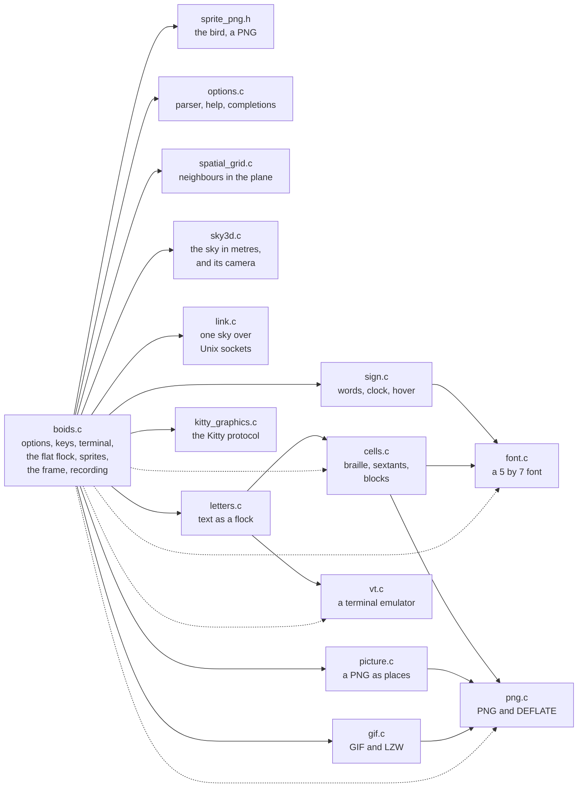
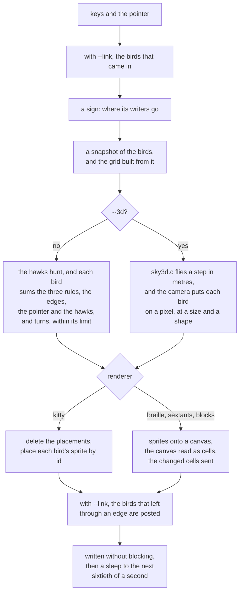

# cbirds, under the hood

<p align="center"></p>
<p align="center"><sub><code>pygmentize boids.c | cbirds</code>: cbirds reading its own code, the function that makes the flock flee a hawk</sub></p>

<p align="center">
<a href="https://github.com/clainstone/cbirds/actions/workflows/tests.yml"></a>


<a href="../../LICENSE"></a>
</p>

cbirds is a flock of birds in your terminal: Craig Reynolds' boids, drawn in
braille in any terminal and as real sprites over the Kitty graphics protocol in
Kitty and Ghostty. It also flies the text you pipe into it, a murmuration in three
dimensions, and one sky shared by several terminals. This page is about how it is
made: one program in C99 with no dependencies, for Linux and macOS. The PNG, GIF
and DEFLATE code is all in the repository; there is no zlib, no libpng, no
ncurses.

```
git clone https://github.com/clainstone/cbirds
cd cbirds
make
sudo make install
cbirds
```

Homebrew and apt are under [Install](#install).

## The modules

Each arrow is an `#include`: who uses whom. The dotted ones are `boids.c` using
a lower module directly as well.



| file | what it is |
|---|---|
| `boids.c` | The program: the options table, the keys and the pointer, the terminal, the flat flock and its hawks, signs as formations, the sprites, the frame loop, the glue for `--link`, recording and `--bench`. |
| `sky3d.c` | A murmuration in three dimensions, in metres and seconds, and a camera that orbits it. Nothing in it knows about pixels, sprites or the terminal. |
| `spatial_grid.c` | A uniform grid for the flat flock's neighbour search, rebuilt every frame without allocating. |
| `vt.c` | A small terminal emulator: bytes in, a grid of styled cells out. |
| `letters.c` | Text as a flock: which letter is where, when each one leaves, and what the screen shows. Where a letter is while it flies belongs to the flock. |
| `link.c` | One sky shared by several windows, over Unix datagram sockets. Nothing in it knows what a bird is. |
| `cells.c` | A frame as terminal cells, for terminals that draw no images, and only the cells that changed. Nothing in it knows about birds. |
| `kitty_graphics.c` | The Kitty graphics protocol: uploads, placements, synchronized updates. |
| `gif.c` | The GIF encoder: a colour table built from the frames, and LZW. |
| `png.c` | PNG decoding and encoding, DEFLATE both ways, rotation and resizing. |
| `sign.c` | What a flock needs to know to be a sign, with nothing of the flock in it. |
| `picture.c` | A PNG as places for birds, spread evenly over its opaque part, and its colours. |
| `font.c` | A 5 by 7 bitmap font, drawn in the source as rows of `#`. |
| `options.c` | The options as a table: the parser, `--help` and the completions come off the same data. |
| `sprite_png.h` | The bird: one PNG, compiled into the binary. |

## A frame



The rate is sixty frames a second, and every speed and turn is a quantity a
second, scaled by how long the frame really took. A frame flies first and draws
after, so the screen shows the step just taken, hawks and birds alike. Paused, it
still draws and reads keys, so the panel answers. Both renderers queue the frame in
one buffer, between the two halves of a synchronized update, and write it without
blocking; while the terminal drains it, the keys are still read.

## The flat flock

<p align="center"></p>
<p align="center"><sub><code>cbirds --render kitty --hawks 2 --color ice --speed 0 -n 300 -s 14</code></sub></p>

Every frame copies the birds into a snapshot and builds a grid of 12 pixel cells
over it, so a bird's neighbours are found in the cells round it rather than among
all the birds. Each bird then reads only the snapshot. Separation counts every
bird within its perception radius (12 to 60 pixels, 36 by default); alignment and
cohesion count only its own flock, so two flocks pass through each other and
refuse to merge. A bird of `--depth`'s far sky sees only the far sky. To the three
rules are added the edges, the pointer and the hawks, and the bird turns towards
the sum by no more than the turning slider allows in a frame. That limit is what
gives curved fronts instead of a cloud snapping into shape.

With one flock a bird's shade comes from its heading, so a turn runs a ripple of
colour through the flock; with two or three it comes from the flock. Above 1x on
the speed slider a frame is flown in as many equal steps as the speed needs, so a
fast flock flies faster and not worse.

## Sprites, built once

The bird is one PNG, compiled into the binary as `sprite_png.h`. At startup it is
rotated into sixty headings, six degrees apart, squashed across its line of
flight into three wing positions, and tinted into every shade of the ramp: about
fifteen hundred small images. Each rotation is made at six times the final size,
at most 256 pixels, and then scaled down, which keeps small sprites clean; every
shade of a heading is a copy of one rotation, since the rotation is the expensive
half. The wings beat six times a second, out, half, folded, half, and now and then
a bird that has finished a beat holds its wings out and glides. Far birds are
smaller and dimmer, hawks are twice a bird, and tails are faded copies.

In `--3d` a bird is drawn at one of five sizes, by its distance, dimmer the
further it is, and in one of six shapes: its length and its span foreshortened as
the camera sees them. When the window settles at a size at least a twentieth
different from the one the sprites were made for, they are made again.

With `--render kitty` the sprites are sent to the terminal as PNGs, once, and
again only when they are made again; for the text renderers they stay in memory
as pixels.

## Two ways to draw

**Kitty.** `kitty_graphics.c` uploads every sprite as a PNG under an image id of
its own, in base64, in chunks of 4096 bytes. A frame is then a synchronized
update (`CSI ? 2026 h` to `CSI ? 2026 l`) that deletes the last frame's
placements and places every bird by id, at its cell and its pixel offset in the
cell: the far birds underneath, the hawks on top. This is
[the Kitty graphics protocol](https://sw.kovidgoyal.net/kitty/graphics-protocol/),
and `--render kitty` is made for Kitty and Ghostty. WezTerm, Konsole, iTerm2,
Warp and Rio answer for the protocol and then draw too few birds, the wrong ones
or none; inside tmux the sprites never reach the terminal.

**Cells.** Everywhere else, and by default, the sprites are composed onto an RGBA
canvas the size of the screen, as they are for a recording, and `cells.c` reads
the canvas back as cells: two by four dots a cell in braille, two by three blocks
in sextants, two half blocks in blocks. A dot is lit when its patch is a quarter
ink or more, and the cell wears the colour that covers most of it, not the mean,
so two birds in one cell do not make a third colour that changes every frame. In
`--3d` the cells a hawk's sprite touches are given the hawk's colour, which two
thousand birds round it would otherwise outvote. Only the cells that differ from
the last frame are sent, with the cursor moved as little as it can be, in 24-bit
colour when `COLORTERM` says the terminal has it and otherwise in the nearest
colour of the 256-colour cube. The background is never painted: blocks uses the
upper or the lower half block so that an empty half is the terminal's own ground.

<table>
<tr>
<td align="center"><br><sub><code>cbirds --hawks 2 --color ice</code>: braille, what any terminal shows</sub></td>
<td align="center"><br><sub><code>cbirds --render sextants --color acid</code></sub></td>
</tr>
</table>

## Text as the flock: `vt.c` and `letters.c`

fastfetch and neofetch do not print lines, they place things: a logo, then a
cursor that goes back up and across to write the information beside it. Read as
lines, that is a staircase. So what comes down the pipe is fed to `vt.c`, a small
terminal emulator, and cbirds keeps what a terminal would show when the command
finished. It understands UTF-8 with wide characters, cursor movement and erasing,
SGR colours and attributes (the 16, the 256 and 24-bit), saving the cursor and
autowrap; any other sequence is read to its end and thrown away, and feeding it
never allocates. A pipe is read until it ends, or has been quiet for a second and
a half, or has gone on for eight seconds, or has sent a megabyte, and the last
screenful is kept. A pipe that sends nothing for three seconds gives the ordinary
flock.

`letters.c` makes a letter of every cell with a glyph in it, carrying the glyph
and the style the command gave it, with the middle of its cell as its home, and
runs the cycle: the text at rest as it was printed, a wave that startles the
letters one by one from one point, a flight with the flock, a call home, and every
letter landing on its own cell, exactly. A letter at home is drawn as the command
printed it; a letter with no colour of its own takes the flock's while it flies.
The cycle runs on the caller's clock, so a paused flock stands still and a
recording is the same every time.

<table>
<tr>
<td align="center"><br><sub><code>cat docs/clips/fetch.ans | cbirds</code>: a screen in the manner of fastfetch, the information beside the logo, kept</sub></td>
<td align="center"><br><sub><code>cat docs/clips/sunset.ans | cbirds</code>: a picture in █ characters, every cell back where it was</sub></td>
</tr>
</table>

```
fastfetch | cbirds
git log --oneline --graph --color=always | cbirds
figlet -f big hello | cbirds
cbirds --text poem.txt
```

## Three dimensions: `sky3d.c`

<p align="center"></p>
<p align="center"><sub><code>cbirds --3d --color prism --hawks 1</code>: the colour runs with depth, red near, blue far</sub></p>

`--3d` flies 2000 birds over a roost. Positions are in metres, and each bird has
a heading in three dimensions, a speed and a bank.

- **Neighbours.** A bird heeds its seven nearest neighbours however far off they
  are, as starlings were measured doing (Ballerini et al., PNAS 2008), rather than
  everything within a radius. They are found exactly, the same list a search
  through every bird would give, through a grid over the flock's own bounding box
  whose cell is measured again at every step, at about the distance of the
  seventh neighbour.
- **Rules.** Alignment with the neighbours' headings; cohesion only for the part
  of the way to their middle beyond half a metre, so it is the edge of the flock
  that is drawn in; separation from any neighbour nearer than 1.1 metres.
- **No walls.** A bird more than ten metres from the roost sideways, or two above
  or below the height it prefers, is called home, the harder the further it has
  gone (Hildenbrandt, Carere and Hemelrijk, Behavioral Ecology 2010). The air over
  the roost moves, in five slow waves longer than the flock, and every bird leans
  into it a little: the front of the flock feels a different push from the back,
  which bends and folds it into sheets and ribbons.
- **Turning.** The heading turns at a limited rate a second, and up or down at
  about half of it, never more than 0.3 of a radian from level; a bird leans into
  a turn as far as the turn is sharp. Climbing costs speed, diving gains it, and a
  bank costs a little.
- **Hawks.** A hawk picks a bird, commits, dives when it is near, passes through
  and climbs back for another. The birds flee it partly sideways, on the side they
  are already turning, so the flock opens, streams past and closes behind; with a
  hawk on it a bird turns up to three times as fast.
- **The pointer** is a ray from the camera through it: birds within five metres of
  that line move off it.
- **The camera** goes once round the roost every two minutes, rising and sinking
  over 96 seconds, looks nearly at the flock's middle, and stands off 2.6 times the
  flock's size, easing out quickly when the flock spreads and in slowly when it draws
  together. Its view is wide, nearly sixty degrees, so that the near edge of a
  flock is a good deal nearer than the far one and the sizes say something.
- **Before anyone looks** the flock flies eight seconds unseen, in steps of a
  thirtieth of a second at most, so that it is a flock and not a cloud when it is
  first drawn.

The panel's sliders are weights on the same rules: `boundary` becomes `roost`, and
`perception` becomes `neighbours`, one more a notch, seven at the default and 1
to 13 in all. The birds are 8 pixels, 5 in the text renderers, and the default
ramp is **ink**, from the terminal's own text colour to its background, asked of
the terminal at startup; a terminal that does not answer, and every recording, get
`ash`. Every renderer draws it:

<p align="center"></p>
<p align="center"><sub><code>cbirds --3d --render braille --color dusk</code>: the same sky through <code>cells.c</code>, the hawk's cells in its own colour</sub></p>

## One sky: `link.c`

<p align="center"></p>
<p align="center"><sub>three real windows, <code>cbirds --link --color prism --render sextants -n 220 -s 11 --hawks 1</code> in each, recorded through cbirds' own terminal emulator</sub></p>

Each `cbirds --link` binds a Unix datagram socket in a directory of your own,
`$XDG_RUNTIME_DIR/cbirds`, or `$TMPDIR/cbirds-UID`, or `/tmp/cbirds-UID`, which must
be a directory, belong to you, and be writable by nobody else. The socket is
named for the moment it joined and its process, so listing the directory gives the
order: the windows lie in a row, left to right, in the order they were started,
and a window's neighbours are the one before it and the one after.

About once a second a window lists the directory and tells its neighbours
whether it has room for another bird and another hawk; a neighbour not heard from
for three seconds is not trusted with a bird. A bird whose middle crosses an edge
with a neighbour behind it is posted as a traveller: where it left, as a share of
the window's height, so that windows of any size line up; how far past the edge it
had gone; its direction; its flock, shade, layer and wing.
Up to eight travellers go in one datagram of a fixed size, its integers big
endian. The sockets never block, and a datagram the other side does not take is a
bird the sender keeps, so nothing is lost between windows.

```
cbirds --link        # in one terminal
cbirds --link        # in another
```

## Signs and pictures: `sign.c`, `picture.c`, `font.c`

<table>
<tr>
<td align="center"><br><sub><code>cbirds --clock-at 10:09:52</code></sub></td>
<td align="center"><br><sub><code>cbirds --picture docs/scene.png --shape dot -n 1500 -s 16</code></sub></td>
</tr>
</table>

A sign is a formation. Every bird that writes is given a place in a letter and
steers at it and at nothing else, and its last step is the distance left, so a
letter is crisp instead of a cloud circling one. `sign.c` cleans the words down to
what the 5 by 7 font of `font.c` can draw (capitals, and an accented letter as its
plain one), wraps them onto one, two or three lines, whichever makes the letters
largest, writes the clock's text in the twelve or twenty-four hours the locale
asks for, gives each writer a small loop of its own to hover round its place, and
keeps the rest of the flock out of a box round the sign. `picture.c` spreads as
many places as there are birds evenly over the opaque part of a PNG, in pieces of
equal area, and cuts its colours to at most eight by median cut.

## The numbers

| CPU a frame | 800 birds | 4000 birds |
|---|---|---|
| sprites, `--render kitty` | about 0.5 ms | about 3 ms |
| braille, the default | about 3 ms | about 10 ms |

Braille costs more because every frame is painted and sampled down to dots. In
3D, 2000 birds cost about 3 ms a frame in braille and 1.7 ms with Kitty sprites,
measured on one desktop machine.

`cbirds --bench 300` measures your machine. It opens no terminal: it builds 300
frames of a screen of 200 by 50 cells, 1600 by 800 pixels, into the output buffer
and counts them, then prints the frame time, the frame rate that allows, the bytes
a frame and the megabytes a second at sixty frames. It measures sprites unless
`--render` asks for another renderer.

| | |
|---|---|
| frames a second, live | 60 |
| headings a sprite is rotated into | 60, six degrees apart |
| small images built at startup | about 1500 |
| wing beats a second | 6 |
| birds | 1 to 4096; 800 by default, 2000 in `--3d` |
| sizes a bird is drawn at in `--3d` | 5 |
| neighbours a bird heeds in `--3d` | 7 by default, 1 to 13 |
| frames a second a GIF carries | up to 50 |

## How the recordings are made

<p align="center"></p>
<p align="center"><sub><code>./donut | cbirds</code>, with <code>docs/clips/donut.c</code>, after Andy Sloane's donut.c: one whole cycle, 34 seconds, ending on the text as it was printed</sub></p>

```
cbirds --record flock.gif --hawks 2 --seed 5
cbirds --record flock.cast --record-fps 30
cbirds --snapshot frame.png --frames 400
cbirds --3d --record murmuration.gif --color prism
```

`--record` opens no terminal. The simulation steps at the recording's own frame
rate, on its own clock rather than the wall's, and without `--seed` it takes a
fixed seed, so the same command makes the same frames however long each takes to
compute. Each frame is composed onto a canvas with a dark ground, or, with
`--render braille | sextants | blocks`, painted as cells the way a text terminal
shows them; text is drawn with the 5 by 7 font in cells of 12 by 20 pixels. A
recording of text runs a whole cycle, 34 seconds, and ends on the text as it was
printed; any other runs 6 seconds unless `--record-seconds` says otherwise.
`--record-size COLSxROWS` goes from 40x14 to 400x120, 96x26 by default.

`gif.c` chooses the colour table once, from the first frame: colours are counted in
32 levels a channel, the 256 most frequent become the table, and every bucket is
pointed at its nearest entry once, so a pixel is mapped with one lookup. Colours a
later frame will need and the first does not show are added before it: the flock's
colours, for text, which starts at rest in its own; in `--3d`, the sprites' own
tints, since a far size or a hawk may not be in view yet. Then LZW. A GIF's delay
is whole hundredths of a second, so the only rates it has are 100/1, 100/2,
100/3 and so on, and viewers take anything under two hundredths as a tenth: 50 is
the most, and a rate asked for is rounded to the nearest the format carries, with
a note to say so.

A name ending in `.cast` gives an asciinema recording instead: a JSON header, and
then a line a frame of what the braille renderer would have sent, which is only
the cells that changed. `--snapshot FILE` writes the last live frame as a PNG,
with `png.c`'s own encoder: LZ77 with fixed Huffman codes.

Every clip on this page was recorded by cbirds itself. The framed ones are the same
frames inside a drawn terminal window whose title bar names the command, and
`link.gif` is three real windows recorded through cbirds' own terminal emulator.
[docs/clips/README.md](../../docs/clips/README.md) has the commands and the tools
that frame them, and [docs/README.md](../../docs/README.md) the commands behind the
older clips.

## Building and testing

```
make                        # one binary, cbirds
make test                   # every test program, stopping at the first that fails
sudo make install           # one file, /usr/local/bin/cbirds
make install PREFIX="$HOME/.local"
```

The makefile compiles with `-std=c99 -Wall -Wextra` and links the C library's
`-lm`; `CC`, `CFLAGS` and `PREFIX` can be given from outside, and a `CFLAGS` of
your own replaces the optimisation, never the language standard. `make test` builds
thirteen test programs, one for each module but `font.c`, which the cells, sign and
letters tests take in, and `boids_test` for the program as a whole. `make asset`
makes `sprite_png.h` again from `matrix.png`, through `mkasset.c`, which checks the
image with cbirds' own decoder first.

## Install

Homebrew, on macOS and Linux:

```
brew install clainstone/tap/cbirds
```

apt, on Debian 12, Ubuntu 22.04 and later and their derivatives, amd64 or arm64,
from https://clainstone.com/apt :

```
sudo apt install curl
curl -fsSL https://clainstone.com/apt/cbirds.gpg | sudo tee /etc/apt/keyrings/cbirds.gpg >/dev/null
echo "deb [signed-by=/etc/apt/keyrings/cbirds.gpg] https://clainstone.com/apt stable main" | sudo tee /etc/apt/sources.list.d/cbirds.list
sudo apt update
sudo apt install cbirds
```

Both come with completions for bash, zsh and fish, and `brew upgrade` or
`sudo apt upgrade` keeps them up to date. The `.deb` files alone are on the
[release page](https://github.com/clainstone/cbirds/releases/latest). From source,
see the top of this page.

<details>
<summary>Uninstall</summary>

```
brew uninstall cbirds
brew untap clainstone/tap
```

```
sudo apt remove cbirds
sudo rm /etc/apt/sources.list.d/cbirds.list /etc/apt/keyrings/cbirds.gpg
sudo apt update
```

From source: `sudo make uninstall` in the clone.

</details>

## Using it

```
cbirds                              a flock, in braille
cbirds --render kitty               sprites, in Kitty or Ghostty
fastfetch | cbirds                  the letters of anything take flight
cbirds --3d                         a murmuration in three dimensions
cbirds --link                       one sky across terminals
cbirds --say "back in five"         the flock writes it, and holds it as a sign
cbirds --screensaver --clock        a lock screen that tells the time
```

Keys: `h` the panel of sliders (`b` `s` `a` `t` `p` `v` `g`, lowercase lowers and
uppercase raises), `Space` pause, `.` one frame, `0` the defaults, `Tab` the next
preset, `+` `-` birds, `k` `K` hawks, `e` tails, `Enter` letters off or home, `q`
quit. The [manual](../../docs/manual.md) has the details.

## Credits

Much of cbirds' code, tests and documentation was written by large language models (Claude, by Anthropic), under my direction.

- Craig Reynolds, *Flocks, Herds, and Schools: A Distributed Behavioral Model*,
  SIGGRAPH 1987; [red3d.com/cwr/boids](https://www.red3d.com/cwr/boids/)
- Ballerini et al., *Interaction ruling animal collective behavior depends on
  topological rather than metric distance: Evidence from a field study*, PNAS 2008
- Hildenbrandt, Carere and Hemelrijk, *Self-organized aerial displays of
  thousands of starlings: a model*, Behavioral Ecology 2010
- The [Kitty graphics protocol](https://sw.kovidgoyal.net/kitty/graphics-protocol/)
- The donut in the donut clip is after Andy Sloane's donut.c (2006).

## License

MIT, by Alessandro Palliccia. See [LICENSE](../../LICENSE).
