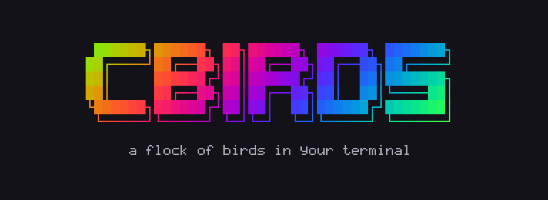

# Twenty READMEs

Twenty ways to show cbirds, for the release that brings `--3d`, `--link` and the
new clips; one of them will be the README. Each folder holds one `README.md`, and
GitHub shows it when the folder is opened. They all say the same true things, in
twenty different shapes.

| # | README | the idea | opens with | lines | weight |
|---|---|---|---|---|---|
| 01 | [Marquee](01-marquee/) | the logo, a huge 3D hero, and three feature cards | `3d-prism.gif` | 420 | 49 MB |
| 02 | [Bento](02-bento/) | a grid of ten clips of different sizes as the first screen | `3d-prism.gif` | 322 | 42 MB |
| 03 | [Anything can fly](03-anything-can-fly/) | text piped in first: the six pipe clips, then the rest | `pipe-donut.gif` | 311 | 34 MB |
| 04 | [Terminal cinema](04-terminal-cinema/) | fourteen scenes, each a command and its clip | `pipe-banner.gif` | 551 | 50 MB |
| 05 | [Keynote](05-keynote/) | big statements, one clip each, the install as the one more thing | `3d-prism.gif` | 316 | 29 MB |
| 06 | [Zig-zag](06-zigzag/) | a landing page: text and clip alternating, row by row | `pipe-banner.gif` | 460 | 34 MB |
| 07 | [The man page](07-man-page/) | NAME, SYNOPSIS, OPTIONS, EXAMPLES, with clips for the examples | `pipe-code.gif` | 501 | 37 MB |
| 08 | [The science](08-science/) | the model as equations, numbered figures and references | `3d-aurora.gif` | 537 | 32 MB |
| 09 | [The wall](09-wall/) | every clip as a thumbnail with its command, before any text | `pipe-donut.gif` | 389 | 62 MB |
| 10 | [Zen](10-zen/) | one hero, five commands, the install, under 80 lines | `pipe-donut.gif` | 62 | 10 MB |
| 11 | [A day in your terminal](11-a-day-in-your-terminal/) | a story, from the morning fetch to the lock screen at night | `pipe-banner.gif` | 368 | 34 MB |
| 12 | [Release notes](12-release-notes/) | what is new, each with its clip, then everything else | `3d-prism.gif` | 322 | 43 MB |
| 13 | [ANSI art](13-ansi-art/) | a retro BBS page: block letters, box drawing, menus of keys | `pipe-banner.gif` | 455 | 30 MB |
| 14 | [The keyboard](14-keyboard/) | built around the keys and the panel | `3d-prism.gif` | 409 | 38 MB |
| 15 | [Modes and renderers](15-matrix-of-modes/) | tables that cross modes, renderers and ramps | `hawks.gif` | 402 | 56 MB |
| 16 | [The lock screen](16-lock-screen/) | the screensaver and the clock first, then the rest | `clock.gif` | 346 | 38 MB |
| 17 | [Playful](17-playful/) | emoji, GitHub alerts and jokes that are true | `pipe-code.gif` | 385 | 43 MB |
| 18 | [Under the hood](18-under-the-hood/) | for developers: the modules, a frame, the numbers | `pipe-code.gif` | 481 | 33 MB |
| 19 | [Poster](19-poster/) | almost only pictures, one line each | `3d-prism.gif` | 199 | 45 MB |
| 20 | [Questions](20-faq/) | the questions people ask, each answered with a clip | `pipe-donut.gif` | 389 | 48 MB |

**Weight** is what the page's pictures add up to. The README at the top of this
branch loads about 10 MB; these load from 10 to 62, because each shows many of the
new clips, which are 34 seconds long when they are text. Whichever is chosen, its
clips can be trimmed to the ones it needs.

The clips are in [docs/clips](../docs/clips), and
[docs/clips/README.md](../docs/clips/README.md) says how each was made: every one
was recorded by cbirds itself, and [make/build.sh](../docs/clips/make/build.sh)
makes them all again.
